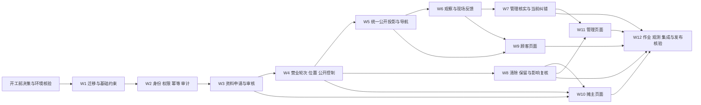

# 一期实施计划

> 开发前准备资料第 5 项／共 6 项。状态：待审稿，尚未实施。本计划规定一期 MVP 的实施依赖、工作包、阶段检查和上线门槛；它不授权开始编码、迁移真实数据或发布。第 6 项《测试与交付方案》将另行规定完整测试矩阵、环境、人员、演练和交付记录。

## 1. 目标、依据与执行原则

以[一期 MVP 需求文档](MVP/一期MVP需求文档.md)的 C-01～C-03、V-01～V-04、O-01～O-03、AC-01～AC-20、R-01～R-08 为验收依据；以[页面与交互方案](一期页面与交互方案.md)的 P01～P18 为页面范围；以[技术设计](一期技术设计.md)和[数据模型与接口约定](一期数据模型与接口约定.md)为技术与 HTTP 契约。[现有项目差距清单](一期现有项目差距清单.md)只说明源码现状，不代表真实环境或功能验收。

一期交付人工审核、定位开摊、当前发现与导航、手动及到时收摊、现场反馈与人工纠错、本人公开控制与资料清除，以及必要的权限、审计和试点观测。日历、预约、关注、信用、最近位置公开、完整人员授权工作台和永久注销均不进入实施包。旧的六个功能 changes 不作为本计划的拆分或执行依据。

每个工作包在实施时独立走“契约例与失败例 → 最小实现 → 自动检查与人工核对 → 评审”闭环；跨包集成再做端到端检查。表、路由、页面可按下列建议路径落地，若源码或真实环境要求不同，先更新对应工作包和接口契约，再改代码。2026-11-01 用户确认一期可从空库按文档重新开始，不迁移旧数据库或兼容旧迁移历史；现有未提交文件仍须保留，不能以重建目录为由清理工作区。

## 2. 开工前决策与环境核验

下表不是已完成事项。第 5 项可以先审阅，实际开发对应工作包前必须取得结果并记录到实施记录；发现与前四项冲突时先修订来源文档。

| 编号 | 必须确认或核验的内容 | 进入哪个工作包前完成 | 未解决时的处理 |
| --- | --- | --- | --- |
| G-01 | 公告是否必填；名称、常卖内容、价格、公告、位置名称、反馈说明的长度与计数规则；一期品类码及页面文案 | W3 资料、W9～W11 页面 | 第 4 项的 1～40／1～200／1～120／1～300 字等是待审建议，不以旧包装的缺省值替代；保持相关工作包待启动 |
| G-02 | 目标 MySQL 版本、字符集、时区、索引长度、可空生成列唯一约束、事务与锁行为；一期空库初始化 | W1 数据库 | 在空的隔离库做 DDL 与并发探针；不在生产库试错 |
| G-03 | 旧公开路由和消费者、一期公开入口启用条件及回退边界 | W5 公开切换 | 不迁移旧 `cb_vendor_locations`；不能证明旧公开路由已关住前不开放一期顾客入口 |
| G-04 | 微信／云托管身份头的可信边界、服务直连防护、管理角色账号、作业身份与调度、容器内脚本及密钥注入 | W2 身份、W12 作业 | 生产配置缺失时拒绝管理及写操作；本地模拟身份不得进入生产 |
| G-05 | 试点范围、预计公开集合规模、真实网络与设备、数据库容量和回退环境 | W5 查询方案、W12 集成 | 先测完整集合、并发与时效；若超出目标，修订查询／同步协议，不静默截断地图 |
| G-06 | 前四项待审稿中与实现有关的变更及版本冻结 | 各受影响工作包 | 记录变更、受影响页面／表／接口／测试，再决定是否重排顺序 |

实施记录至少保存：决策人或核验人、日期、环境、实际值或证据、对应契约修订、受影响工作包。真实账号、密钥、数据库地址和顾客精确位置不写入计划或普通检查记录。

## 3. 依赖顺序与代码落点

后端沿用 `backend/src/` 的 Express、mysql2、迁移运行器和路由装配；小程序沿用 `miniprogram/` 的页面、API 包装与通用状态组件。每个新领域命令只通过自己的服务模块写库；身份、主库时间、幂等、审计和公开资格分别收口，不让页面或旧位置查询另算状态。以下路径是实施时的预期改动面，`W` 编号是计划工作包，不是已创建的开发任务。

## 4. 工作包与完成条件

### W1. 迁移基线与一期数据表

**依赖：** G-02；无其他业务包。**改动面：** 独立的一期迁移运行器与迁移目录、`backend/scripts/migrate.js`、数据库约束检查。只从空库建立一期元数据表和数据表，不加载旧位置迁移链，不修改旧迁移文件。按账号／资料、轮次／位置／限制、反馈／处理、清除／保留／审计分批建表；新 `cb_vendor_sessions` 与 `cb_session_locations` 不复用旧 `cb_vendor_locations` 的公开语义。

- [ ] 在一次性空库执行迁移、重复执行及状态查询；拒绝非空旧库作为首次迁移目标，检查失败可定位且不误称 DDL 自动回滚。
- [ ] 在目标 MySQL 版本验证活动唯一约束、字段长度、索引和 `DECIMAL` 坐标；运行并发插入证明同摊主不能双待审、双活轮次或同轮双活位置。
- [ ] 确认一期迁移命令不会加载旧位置迁移；旧数据不导入一期库，也不生成一期轮次或出摊日。

**完成判据：** 空隔离库可向前迁移且重复执行稳定；约束可复现；生产启用与回退边界有审阅记录。回退原则是先停止新写和切换公开入口，再恢复应用版本；已有新业务事实不能靠删表回退。

### W2. 可信账号、权限与共用命令底座

**依赖：** W1、G-04。**改动面：** `backend/src/middlewares/auth.js`、`operator-auth.js`、`job-token.js`、`backend/src/routes/index.js`，建议新增 `backend/src/domain/account/`、`authorization/`、`idempotency/`、`audit/` 与对应 `routes/v2/me.js`。同一微信身份只对应一个最小账号；管理授权来自受控配置或授权表，入口隐藏不代替服务端鉴权。所有写接口统一 `Idempotency-Key`、请求摘要、状态查询、主库时间、期望版本和审计失败回滚。

- [ ] 验证匿名公开浏览、可信身份建立账号、同账号兼具顾客／摊主／管理资格，以及伪造身份头或撤权后的拒绝。
- [ ] 验证同键同体回放、同键异体冲突、提交后客户端超时再查原键、不同键版本竞争和未知提交结果不误报 `FAILED`。
- [ ] 验证错误体不泄露 SQL、openid、坐标、令牌或受限证据；审计写入失败使业务事务回滚。

**完成判据：** 本人及管理资源读写均逐次鉴权；网络重试不会制造第二次成立结果；生产身份边界未核实时不得启用写接口。

### W3. 资料版本、审核与本人资格

**依赖：** W2、G-01。**改动面：** 建议新增 `backend/src/domain/profile/`、`backend/src/routes/v2/profile.js`、`profile-reviews.js`；接入 `/me`、`/vendor/profile-submissions`、`/management/profile-reviews`。提交内容不可原位改写；首次待审／驳回不公开也不开摊；修改待审／驳回仍保持旧生效版本。审核通过在单事务切指针、记决定和审计。

- [ ] 覆盖字段空白、控制字符、未知品类、长度边界、未知字段与前后端同口径；驳回原因必填。
- [ ] 并发审批同一申请仅一个终态；旧页版本冲突不覆盖新结果；清除中相交申请不能后来获批并恢复公开。
- [ ] 本人快照能区分首次、待审、驳回、已生效与修改待审，且不向顾客泄露待审内容。

**完成判据：** AC-02、AC-12 的服务端事实成立；P07／P08／P15 所需读模型可用。

### W4. 营业轮次、位置版本、出摊日与两类公开控制

**依赖：** W3。**改动面：** 建议新增 `backend/src/domain/session/`、`publication/`，接入 `routes/v2/vendor-sessions.js`、`vendor-publication.js`、`governance.js`。开摊尝试和定位上下文先成立，定位成功后以同一事务创建轮次、初始位置、当地出摊日及审计；失败与取消不形成营业。刷新只在指定轮次替换位置；手动、到期、本人停止、治理暂停及明确的管理纠错共用结束契约。本人和治理限制有独立列与版本，恢复一方不清另一方、不恢复旧轮。

- [ ] 核对首次 4 小时候选、30 分钟取整、上次钟点重新确认、`N<E` 与最多 12 小时；取得锁后跨越截止须再取主库时间重验。
- [ ] 并发开摊只成一轮；同日重开只计一个出摊日，跨零点不自动计次日；刷新失败保留最后成功位置，成功替换写旧版自身停止时刻。
- [ ] 手动／到期／限制／纠错并发仅一条有效终态；到期作业延迟时新读取立即按休息处理；旧请求和旧作业不能操作新轮。
- [ ] 双重限制两种解除顺序都保持独立；限制成立时同事务结束轮次和当前位置，清除资料后恢复本人选择仍须重新审核。

**完成判据：** AC-03～05、AC-08～09、AC-11、AC-14、AC-19～20 的权威写入基础成立；工作台和管理端可读取自身状态，顾客公开仍由 W5 单独放行。

### W5. 统一公开投影、当前发现与导航复核

**依赖：** W4、G-03、G-05。**改动面：** 建议新增 `backend/src/domain/public/`、`backend/src/routes/v2/public-vendors.js`；检查并改造 `routes/v2/vendors.js`、`domain/location/public-position.js`、`location-service.js`。列表、地图、详情、导航复核只使用同一资格谓词和字段白名单；顾客位置仅在请求体内参与本次距离计算。休息详情无坐标，限制或清除为不可查看。任何新导航必须在线重取当前轮次和位置；旧 `RECENT_LAST` 及长期有效哨兵不得经旧路由公开。

- [ ] 无顾客定位仍返回完整当前公开集合；品类筛选、稳定排序、距离排序与列表／地图同源；集合过大时先形成完整可达协议再切换。
- [ ] 在截止等号、收摊、位置替换、本人停止、治理暂停、资料清除和断网／主库不可用时，公开响应或导航响应都不带旧坐标。
- [ ] 准备收摊先展示截止和剩余，再确认并二次复核；公开响应 `no-store`，错误体和日志不包含顾客位置。
- [ ] 在隔离环境逐条验证旧公开路由不能绕过新投影；做新旧双读对账但不把旧位置当作新权威事实。

**完成判据：** AC-01、AC-06～07、AC-18、AC-20 的后端条件成立；旧路由泄露风险清零后才可开放顾客入口。

### W6. 平台观察、反馈事实和本人记录

**依赖：** W5。**改动面：** 建议新增 `backend/src/domain/feedback/`、`routes/v2/observations.js`、`field-feedback.js`。详情展示与导航复核产生原轮次／原位置／平台时刻的观察；匿名凭据只可一次性绑定本人。提交时读取原事实而非当前轮次重写，核对反馈窗口、定位上下文、5 分钟和 300 米。待审事项按同人、摊主、事件当地日、类型合并，多条事实保留各自轮次和位置；已结案不重开。

- [ ] 覆盖 5 分钟、300 米恰好上限可受理，超过即拒绝；结束后 30 分钟等号关闭，跨零点按事件日合并。
- [ ] 同观察同类型只写一条事实；不同轮次或位置可进同一待审事项但引用不改写；并发补充与结案不能漏事实。
- [ ] 候选列表到窗关闭后消失，已提交记录仍按权限可查；公开或本人响应均不回传旧坐标与管理受限证据。

**完成判据：** AC-10、AC-15～17 的提交与本人读模型成立；提交反馈本身不触发处罚或自动收摊。

### W7. 管理核实、当前纠错与影响记录

**依赖：** W6、W4。**改动面：** 建议新增 `backend/src/domain/feedback/review-service.js`、`governance/`、`impact/`，接入 `routes/v2/management-feedback.js`、`management-governance.js`、`management-impact.js`。管理列表先给摘要，详情逐次鉴权并记录受限读取。反馈结案须覆盖当时所有事实，逐事实记确认或未确认及原因；无法核实与证明确无异常分开。历史核实不能自动结束新轮次；当前纠错须单独指定当前轮次、版本和依据。已成立影响生成本人可见记录，复核不删除原事实。

- [ ] 事项含两个不同轮次／位置事实时，逐条结果可追溯且试点按原轮次去重；并发新增事实导致旧 `taskVersion` 决定冲突。
- [ ] 旧轮次已结案后同日新开摊，历史纠错请求不能关闭新轮；治理暂停与解除只由 `ADMIN`／`SUPER_ADMIN` 执行。
- [ ] 本人仅见影响摘要、原因和复核结果；反馈人身份、精确坐标及内部证据不进入摊主响应。

**完成判据：** O-02 的管理决定与 AC-11、AC-13、AC-16 的权限和历史隔离可验证；资料审核的 O-01 由 W3 承接。

### W8. 本人资料清除、保留期和人工复核

**依赖：** W4、W7。**改动面：** 建议新增 `backend/src/domain/clearance/`、`retention/`、`impact/`，接入 `routes/v2/data-clear.js`、`impact-reviews.js`。本人先看清除预览再确认；请求成立即停止受影响的公开与轮次、冻结相交待审资料，并生成可重试清理任务。`ACCOUNT_DATA` 如会留下无主摊主，预览须说明并由本人明确改选 `ALL`。位置版本按自身停止时刻起 180 个上海自然日，未结事项及结案后 30 日延期取较晚；一般证据结案后 180 日、受限管理审计发生后 1095 日。清理结果逐类区分隐藏、删除／去标识化和必要保留。

- [ ] 清除请求成功后所有顾客路径立即失去受影响资料和位置；作业失败、重试或迟到审核不能重新公开。
- [ ] 30／180／1095 自然日按上海当地同一钟点计算；未结事项不清理，结案后与基础期限取较晚；延期有依据和新截止。
- [ ] 每批清理可重复执行，保留最小墓碑及审计，不保留已清除的精确坐标；本人能查询超期或部分失败原因。
- [ ] 影响人工复核保留原事实与处理历史，不把申请复核当作自动撤销治理或本人停止。

**完成判据：** AC-19～20、R-07～08 的服务端规则可验证；清除不被写成永久注销。

### W9. 顾客页面 P01～P06

**依赖：** W5、W6。**改动面：** `miniprogram/pages/discover/`、`miniprogram/api/discover.js`、`feedback.js`、`miniprogram/utils/request.js`，建议新增 `pages/detail/`、`pages/field-feedback/`、`pages/feedback-records/`，并更新 `app.json`。P01 列表和地图共用同一结果；P02 导航前在线复核；P04／P05／P06 展示候选、提交和本人结果。前台恢复与网络恢复先复核，过时响应丢弃，失败时标“状态未更新”并禁用新导航。顾客拒绝定位仍可浏览，不取得手机号也可看公开信息。

- [ ] 以 P01～P06 页面状态表逐项对照空、加载、拒绝定位、断网、旧详情、到期、结果未知与已处理场景。
- [ ] 准备收摊确认弹层打开后位置或轮次变化，二次复核失败不得把缓存坐标交给微信导航。
- [ ] 反馈超时使用原幂等键查询；页面不持久化顾客坐标、旧导航坐标或完整受限证据。

**完成判据：** 顾客主链路在隔离环境能从发现走到导航或反馈，所有旧位置和断网场景安全关闭。

### W10. 摊主页面 P03、P07～P13

**依赖：** W3、W4、W8。**改动面：** `miniprogram/api/account.js`、`vendor.js`、`status.js`、`deactivate.js`、`miniprogram/utils/action-resume.js`，建议新增 `pages/mine/`、`vendor-profile/`、`vendor-edit/`、`vendor-workbench/`、`open-days/`、`publication/`、`data-clear/`、`impact-records/`。P03 从同一本人快照显示入口；P09 定位和截止须重新确认；P11 双限制独立显示；P12 先预览再提交。旧 API 包装中的日历、延长、图片、预约、信用等字段不得接入一期页面。

- [ ] 核对首次申请、修改待审、审核驳回、定位失败、刷新失败、手动／到时收摊、同日重开、双重限制和资料已清除后的恢复路径。
- [ ] 写请求超时保留原意图键并查状态，不自动重发新的停止／治理意图；短期恢复标识不含坐标、表单全文或管理证据。
- [ ] 工作台前台同步与最后成功定位时间分开显示，不把旧位置说成后台实时跟踪。

**完成判据：** 摊主能完整操作资料、营业、公开选择和清除，并从本人页面读到真实处理结果。

### W11. 同小程序管理页面 P14～P18

**依赖：** W3、W7、W8。**改动面：** `miniprogram/api/admin.js`，建议新增 `pages/management/` 下资料审核、现场复核、治理、资料争议与影响复核页面；更新 `app.json` 与“我的”入口。菜单依当前服务端权限展示，直接打开旧链接仍重新鉴权。P16 将历史事实与当前营业纠错分区，决定操作单独确认，不默认联动收摊。

- [ ] 无权、撤权、版本冲突、他人已处理、超时结果未知和受限详情访问逐项显示明确结果。
- [ ] 历史事项的多条事实逐条录入结论；当前纠错界面另取当前轮次、版本和依据，不复用历史轮次按钮。
- [ ] 管理列表只显示摘要，受限证据按详情权限显示；治理操作仅管理员／最高权限可见且服务端也拒绝越权。

**完成判据：** 管理人员可完成最小审核、反馈复核、治理和人工复核，且入口或页面缓存不能授予权限。

### W12. 到期与清理作业、观测、集成及发布核验

**依赖：** W1～W11、G-04、G-05。**改动面：** `backend/src/routes/index.js`、`backend/src/middlewares/job-token.js`、`backend/scripts/`、`backend/package.json`、`backend/Dockerfile`、部署配置和受控操作手册。作业分别处理到期轮次、本人清除、保留期清理及每日引用异常检查；每条记录独立事务、按稳定游标重试。试点事件按原操作或轮次去重，只记录最小指标；现场准确性仍需人工核验。

- [ ] 隔离环境执行作业的正常、重复、部分失败与恢复；迟到到期作业不能结束新轮，作业身份不能经小程序网关调用。
- [ ] 构建实际容器，逐一核对脚本与调度是否存在；将 `backend/package.json` 中仍指向不存在脚本的入口修正或移出发布流程。
- [ ] 进行新旧路由对账、完整公开集合容量、并发锁与真实网络测量；核对 R-01 的前台 60 秒，R-02 的 2.5／3／5 秒 95% 目标及 R-03～R-08 的服务端证据。
- [ ] 发布采用“迁移与配置就绪 → 新后端在受控范围验证 → 旧公开坐标入口关闭或接统一投影 → 小程序灰度 → 观察告警”顺序；每步记录回退点。回退应用前先确认不会重新开放旧坐标、旧轮次或已清除资料。

**完成判据：** AC-01～AC-20 端到端逐项有证据，必要的管理和作业能力能在目标环境运行；第 6 项交付方案中定义的正式测试、演练与试点评审通过后，才讨论发布。

## 5. 阶段评审与需求追踪

| 阶段评审 | 工作包 | 必须看到的证据 | 可停留或回退的边界 |
| --- | --- | --- | --- |
| A 基础可信 | W1～W2 | 一期空库迁移、目标 MySQL 约束、可信身份与幂等／审计测试 | 只开放隔离环境；不让新客户端写生产事实 |
| B 核心营业 | W3～W4 | 审核版本、开摊／刷新／结束、双限制和出摊日并发结果 | 新写入口仍受控；尚不开放顾客旧位置查询 |
| C 公开安全 | W5 | 新旧公开路由、截止与隐藏条件、导航复核和容量结果 | 旧路由任一可返旧坐标则阻止顾客切换 |
| D 反馈与资料 | W6～W8 | 原轮次事实、逐事实结论、本人清除与期限／复核结果 | 受限证据仅在有权环境；清理作业先小范围演练 |
| E 页面与运行 | W9～W12 | P01～P18 状态核对、AC／R 证据、作业与部署演练 | 灰度可停止；回退不得恢复已经停止公开的数据 |

| 需求／验收 | 主工作包 | 跨包复核 |
| --- | --- | --- |
| C-01／C-02，AC-01、06、07、18 | W5、W9 | W4 的权威时间和位置、W12 的旧路由及同步测量 |
| C-03，AC-10、15、16、17 | W6、W7、W9 | W4 的原轮次位置、W12 的并发与受限证据 |
| V-01，AC-02、12 | W3、W10、W11 | W2 权限、W8 清除后的旧申请阻断 |
| V-02～V-04，AC-03～05、08、09、14 | W4、W10、W12 | W5 的公开读取和导航截止 |
| O-01～O-03，AC-11、13、19、20 | W3、W4、W7、W8、W10、W11 | W2 权限审计、W5 旧坐标关闭、W12 清理演练 |
| R-01～R-08 | W1～W12 的相关规则 | W12 跨层集成；第 6 项定义正式测试与交付证据 |

所有阶段评审若发现合同、源码、目标环境三者不一致，应先定位差异并修订第 3／4 项和本计划，再继续受影响的工作包。当前各工作包均是**计划**，不是已通过检查或已分配的开发任务。

## 6. 与第 6 项的交接

下一项《测试与交付方案》应把本计划的阶段检查展开为可执行的 AC-01～AC-20／R-01～R-08 测试矩阵，明确环境与测试数据、微信真机和断网场景、性能采样方法、权限及隐私检查、迁移与作业演练、缺陷分级、灰度回退、试点现场抽查及交付签收。第 5 项只规定实施顺序和每包完成判据，不把规划中的“应验证”写成已验证。
