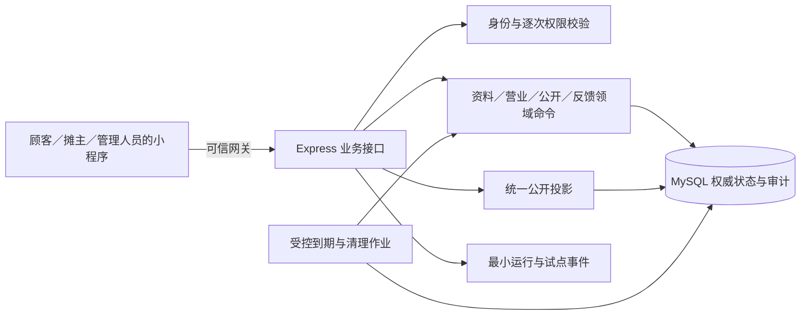

# 一期技术设计

> 开发前准备资料第 3 项／共 6 项。状态：待审稿，尚未实施。本稿确定一期系统职责、权威状态、关键事务和同步策略；具体表字段、HTTP 参数、返回值与错误码在第 4 项《数据模型与接口约定》中定义。

## 1. 依据和范围

业务规则以[一期 MVP 需求文档](MVP/一期MVP需求文档.md)为准；页面入口和可见状态以[一期页面与交互方案](一期页面与交互方案.md)为设计输入；[现有项目差距清单](一期现有项目差距清单.md)说明当前源码与目标的距离。页面方案仍待审，若其入口或流程调整，本设计中相应调用链须同步修订。

一期只完成“人工审核 → 定位开摊 → 顾客发现与导航 → 手动或到时收摊 → 现场反馈与纠错”，加上本人公开控制、资料处理和必要审计。日历、请假、关注、预约、最近位置公开、信用分、完整授权工作台、永久注销均不进入本稿。真实云资源、试点片区、名单、日期和负责人由部署与试点负责人后续配置，不在文档中假定已具备。

## 2. 总体结构与职责

沿用现有微信小程序、云托管中的 Express 服务与 MySQL；一期业务状态集中在服务端和主数据库。小程序负责展示、用户确认、调用微信定位和导航能力、保存一次操作的最小恢复标识；它不能自行判定营业资格、管理权限或历史位置有效性。

| 边界 | 责任 |
| --- | --- |
| 小程序 | 顾客列表／地图／详情共享公开结果；导航每次在线复核；摊主和管理端显示服务端结果；定位授权只在需要时申请；断网明确标记“未更新” |
| Express 路由与领域服务 | 校验输入、身份与资源权限，执行审核、营业、公开控制、反馈和清除命令；只经统一投影输出顾客可见字段 |
| MySQL 主库 | 保存资料生效指针、营业轮次、位置版本、独立公开限制、反馈事实、处理与审计；提供事务、唯一约束、行锁及权威时间 |
| 后台作业 | 关闭到期轮次、执行资料及历史位置清理、记录结果并支持重试；作业延迟不能延长顾客可见营业 |
| 部署配置 | 可信身份网关、最高权限账号、数据库、作业身份和调度、观测告警；生产客户端不得自行注入身份或权限 |

所有顾客公开读取，包括旧的公开位置路径，必须经过同一个资格判断和字段投影。后台受限复核路径单独鉴权，不得被顾客页面或客户端包装复用。

### 2.1 模块边界与现有代码的处理

| 模块 | 一期职责 | 当前基础和必须完成的改造 |
| --- | --- | --- |
| 账号与身份 | 识别同一平台账号，按审核结果赋予摊主资格，按受控配置判断最小管理权限 | 可复用身份挂载骨架；需补账号持久化、可信来源校验和本人上下文；客户端角色切换不创建新账号、不授予资格 |
| 资料与审核 | 保存申请版本、生效版本和审核记录，向本人展示进度及驳回原因 | 现有客户端调用仅是包装；需建立服务端命令、事务与本人／管理读模型 |
| 营业与位置 | 时间候选、开摊、刷新、结束、出摊日和本人工作台 | 可复用坐标校验、数据库事务等局部逻辑；旧位置公开规则必须收口，并补轮次与位置版本的原子关系 |
| 公开发现与导航 | 生成列表／地图／详情的单一公开结果，逐次复核新导航 | 旧区域／半径筛选、`RECENT_LAST` 及长期有效位置不能作为一期顾客入口；地图和详情需接同一公开资格 |
| 反馈与管理纠错 | 保存平台观察上下文、本人反馈、事实合并、人工核实与当前轮次纠错 | 现有 API 包装不能代替服务端；历史事实与当前营业分开处理 |
| 公开控制与资料处理 | 本人停止／恢复、治理暂停／解除、清除请求、受限保留及结果 | 两类限制独立；处理结果、争议与本人可见说明各有读模型 |
| 作业与观测 | 到期收摊、资料清理、有限试点事件和故障告警 | 现有最近位置过期脚本不能替代营业到期；需先修复并验证空库迁移和作业部署路径 |

### 2.2 同一账号的入口与资格

顾客公开浏览无需先建立资料账户，也不强制头像、昵称或手机号。小程序取得可信平台身份后，服务端按唯一平台身份建立或读取最小账号；账号可同时保留顾客使用、摊主申请和受控管理资格。“我的”读取一个本人上下文快照，分别给出账号可识别性、申请／审核状态、当前生效资料是否具备、本人公开选择、治理限制及当前操作权限。页面据此显示 P03、P07、P09 与 P14 的入口；切换界面只改变导航，不改变服务端身份或权限。平台身份暂不可识别时，公开浏览继续可用，本人记录、反馈提交和写操作给出可恢复的身份提示。

首次申请形成待审资料，不立即授予摊主公开或开摊资格；审核通过后本人上下文才出现工作台资格。修改申请期间原资格和生效资料继续按当前限制判断。管理账号也能按同一账号浏览顾客页面；管理操作仍每次按受控角色和目标资源重新鉴权。

## 3. 权威时间与状态

### 3.1 时间来源

平台时间以 MySQL 主库为权威。连接会话统一使用 UTC；每个写事务取一次数据库时刻 `N`，该事务内的状态判断、成立时间、审计时间都使用同一 `N`。公开读取从主库取当前时刻并与本次结果一起判断，不使用小程序时钟、缓存时间或后台任务的实际执行时间决定资格。小程序时钟只用于倒计时显示，临近截止和恢复前台均向服务端复核。应用实例与数据库时钟漂移需监测；不能读取权威时间时，导航和写操作失败关闭。

存储时刻使用 UTC 时间点；按 `Asia/Shanghai` 解释自然日、今天／次日、30／180／1095 个自然日。自然日为 `[00:00, 次日 00:00)`；“自时刻起 N 个自然日”为同一本地时刻至第 N 日对应时刻的半开区间。营业截止和反馈结束后 30 分钟均不含端点。精度与序列化格式留给第 4 项统一定义。

### 3.2 营业资格是不变量

公开营业资格在读取时同时满足：

1. 摊主账号有已审核且仍生效的基本资料；
2. 本人停止公开与治理暂停均未生效；
3. 存在该摊主唯一的当前营业轮次，已开始、尚未结束，且 `S ≤ N < E`；
4. 该轮存在未被替换或停止公开的有效导航位置版本。

其中 `S` 是实际定位开摊成立时间，`E` 是本轮确认的预计收摊时刻，`N` 是权威当前时间。公开业务状态只有“出摊中／休息中”；“准备收摊”由 `R=E-N` 与 `T=min((E-S)×25%, 60 分钟)` 动态推导，`0<R≤T` 时仍为出摊中。它不是可单独写入、可延长或可被旧页面恢复的第三种状态。

若轮次记录尚未被作业物理关闭，但 `N≥E`，所有新读取与导航仍立即当作休息中，且不返回旧坐标。任何需要变更该摊主状态的命令，在取得摊主锁后先采样权威时间，把过期旧轮次按 `E` 终态化，再重验资格并执行新动作；不能因旧记录尚未清理而阻止合法的再次开摊。自动到期的实际结束时间记为 `E`，而不是作业执行时刻。

## 4. 核心写入流程和并发控制

### 4.1 资料申请与审核

摊主资料申请版本和当前生效版本分离。首次申请待审或驳回时没有生效版本，禁止开摊和公开；修改待审期间继续使用原生效版本。审核命令在同一事务内核对申请版本、处理人权限和当前生效指针，通过时原子切换指针，驳回时只写申请结果与原因，不覆盖原资料。审核结果、处理人和平台时间写审计。清除请求成立后，与清除范围相交的待审内容不得再生效；涉及当前公开资料时，所有可能重新公开该资料的旧申请均须阻断，不能因迟到审核恢复已清除内容。

一期资料只接收名称、品类、至少一项常卖内容或商品说明、价格说明和公告；不接收固定出摊地址、图片、日历、预约或福利字段。服务端验证至少一项常卖内容、品类属于一期可用集合及文本输入合法性；长度、空值和错误定位的精确约定留第 4 项。顾客端使用默认品类视觉。P07 的本人快照同时区分当前生效资料、待审版本、首次申请状态、最近审核结果与驳回原因；P15 的管理快照在有权范围内显示申请、生效资料和必要历史。P08 提交后按申请结果回读；字段错误对应原表单项，结果未知时查询原操作，不把本地输入当已生效资料。未提交表单在当前页面内保留并在离开时提示，不默认持久化含个人资料的草稿。

### 4.2 开摊、位置刷新和结束

每次开摊由摊主确认本轮截止时间，再取得本次可导航的定位结果。服务端在提交时用权威时间重验 `N<E`、从实际 `S` 到 `E` 不超过 12 小时、资格和公开限制；首轮候选按当前时间后 4 小时向上取整到 30 分钟，上次有效钟点只作需重新确认的候选。定位失败、取消或时间失效均不提交轮次、位置或出摊日。开摊、刷新和反馈定位应从一次短期服务端定位请求上下文开始，回传后以服务端签发与接收时刻约束新鲜度；客户端报告的定位时间仅作辅助，不能单独作为可信时钟。微信小程序取得的坐标本身并非可由服务端独立证明的现场事实，试点现场抽查与人工复核仍是位置可信度的必要证据。

成功开摊在一个事务中写入唯一当前轮次、首个位置版本及当地开摊日。营业中成功刷新只替换该轮的当前位置：旧版本在同一事务写自身停止公开时刻，新版本写生效时刻与真实定位时间；刷新失败完全不改变最后成功位置。手动收摊、本人停止公开、治理暂停、管理确认当前异常后结束营业、自动到期均走同一结束契约：一次性写轮次终态、当前坐标的停止公开时刻和审计。仅主动成功开摊形成出摊日；同日重开去重，跨零点持续营业不新增次日出摊日。

时间候选由服务端权威当前时间生成或校验：从未有有效选择时推荐当前时间后 4 小时、向上取整到下一个 30 分钟点；有上次成功钟点时按本次“今天／次日”换算，只在仍满足约束时作为候选。与当前时刻相同不能提交，已过的钟点按次日理解，定位完成后还须重验实际开摊到截止不超过 12 小时。P09 工作台由一次本人快照返回资料资格、两类限制、权威时刻、当前轮次、阶段、截止、剩余时间、最后成功位置和真实定位时间；页面倒计时只作显示。定位刷新失败或本轮内长时间未刷新，不给最后成功位置另加超时、打卡或精度门槛；不在后台持续定位。P10 从开摊日与轮次聚合累计出摊天数、当地日记录及必要起止摘要，绝不返回历史坐标或公开历史地图。

所有影响同一摊主营业或公开资格的写操作，在事务内按固定顺序锁定摊主权威行，再处理轮次、位置和限制记录；命令同时携带其读取时的期望版本或目标轮次。版本变化即返回冲突并要求重读，迟到开摊、刷新、恢复和管理操作不能覆盖较新的停止或暂停结果。到期作业必须以目标轮次标识和截止时刻执行，迟到作业不能结束之后新开的轮次。本人停止与治理暂停分别记录版本；恢复本人选择只解除本人限制，治理解除只解除治理限制，均不自动创建新轮次或恢复旧坐标。

### 4.3 幂等与未知结果

每次用户确认的写入意图生成一个稳定操作键，同一次网络重试、重复点击和“结果未知”后的查询复用该键；新意图才生成新键。服务端以“操作者＋操作类型＋键”唯一识别请求，保存请求摘要与终态结果：同键同参数回放原结果，同键不同参数拒绝。幂等只解决重复交付；不同键的并发仍靠行锁、唯一约束和期望版本处理。同键回放只说明当时的操作是否成立，不能证明当前仍在营业；小程序收到回放后仍须读取最新权威状态，再更新页面动作。小程序写入超时不能直接显示失败并换键再发，应先查询操作结果或权威状态；只在确认未成立且用户再次决定时创建新意图。

待恢复标识可在本地短期保存，但不得连同精确坐标、管理证据或完整资料表单持久化。现有通用恢复工具会保存任意参数，不能未经收窄直接用于这些业务动作。

## 5. 公开投影、同步与导航

服务端以同一资格函数生成列表、地图、详情和导航前复核所需结果。列表和地图是同一结果集的两种显示；品类过滤、无顾客定位时的稳定顺序，以及有定位时的距离排序都在这一边界处理。顾客定位仅用于本次距离计算，不写入浏览日志或 URL；拒绝定位仍能看全部当前公开营业对象，也可对当前合格对象发起导航，只是不显示个人距离。现场反馈的本次定位是独立要求，不影响普通浏览与导航。休息详情可显示仍允许公开的生效资料，但没有坐标、距离或导航；本人停止或治理暂停时仅返回不可查看结果。公开响应只含白名单字段，禁止输出历史位置、反馈人身份、管理证据与限制内部原因，并设置不缓存的响应策略。

试点范围是供给与运营前提，不是顾客可选择的区域或半径条件。现有顾客页面及服务端旧入口的区域／半径筛选在一期公开链路中移除或拒绝；只保留品类过滤。无定位时以稳定的公开对象标识作次级排序，有定位时在同品类内按距离优先、同距离再按稳定标识排序，不使用信用排序。P01 列表和地图在同一份权威结果上切换，地图标记从这份结果派生，点击标记展示摘要后进入 P02。试点初期采用完整当前公开集合的快照，使拒绝定位的顾客仍能浏览全部当前摊位；加载更多或地图视口优化只有在保持完整可达、顺序稳定和版本一致的前提下引入。若集合规模使首页 2.5 秒目标或轮询容量不成立，须在实施阶段改进查询／传输并复测，不以静默截断第一页作为地图全部结果。服务端区分“无当前营业”“该品类无结果”和读取失败；顾客定位失败只移除距离及本人位置点，不清空公开列表。

P02 详情使用当前生效资料的最小公开字段：名称、品类、常卖内容、价格说明、公告、营业状态，以及营业时的最新位置更新时间和本轮预计收摊时刻。价格免责声明由页面固定呈现。旧链接指向休息对象时只显示仍可公开的基本资料；限制生效或资料已清除时返回不可查看结果，对象不存在时返回明确的不可用结果。页面收到新投影后丢弃旧坐标、距离与导航动作，不从旧列表或地图记录回填这些字段。

当前已存在 `RECENT_LAST` 公开查询和 `CURRENT_NAVIGATION` 长期有效哨兵。上线前必须使旧公开路由也走一期统一投影，或关闭其顾客访问；不能让旧查询绕过轮次截止、审核及两类限制。每个位置版本的旧坐标只能进入有权复核与保留清理路径。

顾客点击“导航前往”时，服务端必须重新查权威轮次、截止、限制和最新位置版本，成功后才返回本次导航所需坐标。若为准备收摊，先显示预计结束与剩余，用户确认继续时再次在线复核，再调用微信导航能力。页面轮询结果、旧详情、缓存坐标和已打开的确认弹层均不能替代这次复核。断网、复核失败、截止、限制或位置变更时关闭本次导航并刷新页面；位置变更后可让顾客按新位置重新选择导航。已经发起的外部导航不承诺撤回。

前台 P01／P02 的候选实现是约 2 秒短轮询当前公开结果，请求去重并丢弃过时响应；工作台候选为 15～30 秒定时复核，所有相关页在 `onShow` 和网络恢复时立即复核，离开前台停止轮询。恢复前台后首个成功复核前标记“状态未更新”，禁用依赖新鲜状态的导航与写动作；轮询失败时同样清掉“正在营业”的新鲜承诺，成功后才恢复。间隔只是实现起点，须在真实网络、目标样本和负载下分别测量：普通前台状态同步不超过 60 秒；首页与详情主要内容 95% 在 2.5 秒内可用；开摊和收摊 95% 在 3 秒内返回明确结果；成功刷新位置后 95% 在 5 秒内可用于地图、详情和导航。若轮询不能同时满足时效与容量，改用服务端变更通知或更合适的同步机制并复测，不降低需求门槛。新读取和导航永远直接按权威状态判断，不等待前台同步。

## 6. 现场反馈与人工纠错

详情展示或导航复核时，服务端形成最小平台观察上下文：可识别的本人或可在本人入口找回的短期凭据、原营业轮次、当时生效的位置版本、平台事件时刻与当时公开资格。顾客不能自由填写事件时间、挑选历史坐标或从反馈入口取得旧坐标。无头像、昵称或手机号授权仍可浏览；提交反馈时须识别当前平台账号并取得本次位置。若浏览时未完成账号识别，同一小程序内的待反馈凭据可在进入“我的”后受控绑定；具体凭据格式、时效和防重放在第 4 项定义。

反馈提交用服务端平台时刻和原轮次一致性视图核对：事件处于原轮次曾公开营业的时段；该轮仍营业，或在有效结束时刻后不足 30 分钟。显式结束取命令成立时刻；到期作业尚未写终态但已达截止时，结束时刻仍按 `E` 计算。本次顾客定位距提交不超过 5 分钟且距原事件有效位置不超过 300 米。300 米与 5 分钟恰好达上限可受理，到有效结束后恰好 30 分钟不可受理。校验始终绑定原轮次和原位置版本；历史版本仅供受限核验，顾客响应不含旧坐标。位置刷新或同日重开不改变原事实指向。

同一顾客、摊主、异常发生自然日和问题类型最多有一个待处理事项；新事实可以补入该事项，重复事实不重复入库或处理。提交只形成线索，不自动收摊、暂停或处罚。管理端把“核实历史事实”和“纠正当前轮次”分为两个操作；结束当前营业必须另核对当前轮次异常及依据，不能用旧轮次核实结果自动结束新轮次。本人可查必要结果，内部证据和管理备注仅供有权人员查看。

反馈问题限定为“老板不在”“地点不符”“已经离开”，附加简短说明可不填；没有照片或一般内容举报。P04 分开读取本人仍可受理的原轮次入口与已提交记录。候选入口由服务端按有效结束时刻和 30 分钟窗口生成，到点即从未提交列表移除；已提交记录依保留规则继续可查。本人停止或治理暂停后，这些本人入口只给必要事件摘要及结果，不回传被隐藏的摊主公开资料或旧坐标。P05 每次提交都重验原事件、窗口和本次位置；拒绝定位、失败、超过 5 分钟或 300 米时说明原因并允许重新定位，页面内已填说明可以保留，但不得自动改换轮次或事件。合并到同类待处理事项、相同事实重复提交、结果未知后的原键查询，必须给出可区分的结果。

P06 的本人结果投影只展示事件必要摘要、提交时间、问题和“待处理／已核实／未核实”及必要说明。未核实要区分“证据不足、无法核实”和“已证明不存在异常”，不能把两者算作同一个事实结论。P16 管理复核读取原轮次、事件时间、当时公开状态及位置版本和受限证据；作出结论时记录证据摘要、原因、操作人和平台时间。对当前营业采取纠错属于另一次显式命令，先重读当前轮次与当前异常依据。本人可在 P13 查看影响自己的处理结论与必要原因，但看不到反馈人身份、顾客精确位置或管理内部证据。

## 7. 身份、权限、资料处理与保留

生产身份只能来自经核验的微信／云托管可信边界；直连服务不能通过伪造身份头取得账号或管理权限。本地开发身份模拟须与生产配置隔离。公开浏览不强制获取手机号或头像；本人写入和记录读取每次校验账号与资源归属。管理入口按服务端权限显示，但旧链接、读接口和每次写命令仍须服务端重新鉴权。最高权限账号由部署时受控配置，不能由首次访问或客户端参数产生；审核、现场复核、当前纠错、治理和资料争议按操作分别授权，治理暂停／解除仅管理员或最高权限管理员可执行。

本人停止公开成立时同事务结束本轮、隐藏生效资料和全部营业坐标并禁止开摊；恢复只解除本人限制。资料清除请求在本人确认后直接成立，涉及当前公开资料时先停止公开并阻断待审申请重新生效。非必要完整资料从请求成立起 30 个自然日内清除；必要受限记录展示依据与期限，不把“页面隐藏”写成“已删除”，不执行永久注销。

P11 的本人状态快照分别展示“本人已停止公开”和“治理暂停”，附各自成立时间、可见原因和允许的操作；双重限制时恢复一方不改变另一方。P12 将清除范围、成立时刻、最迟完成时刻、处理中／完成／受限保留结果作为可查询状态，资料争议另走最小人工核查，不能成为请求成立的前置审批。P13 展示对本人有影响的审核、纠错、治理和资料处理记录，并提供人工复核申请；P18 的管理结果必须回写本人可见的必要说明。资料清除后的恢复先检查开摊必需资料与审核资格；缺少资料时引导重新申请，通过后仍须重新定位开摊。

每个精确营业位置版本从自身停止公开时刻起算 180 个自然日。关联反馈、申诉或安全事项未结束时阻止清理；事项结束后，仍须将其结束后 30 个自然日与位置自身 180 日期限比较，取较晚者，不能因已结案就提前清理。一般审核和反馈证据从事项结束后默认保留 180 日，管理及高风险治理审计从事件起默认保留 1095 日；后者不自动延长精确坐标。争议延期需有依据、新截止及操作者记录。清理作业按记录类型分别删除或去标识化，支持重试并留下不含已清除精确坐标的执行审计；受限复核须按最小权限读取，顾客接口永不回传停止公开的位置。

## 8. 失败处理与落地前提

| 情形 | 系统处理 |
| --- | --- |
| 定位失败、取消或无可导航坐标 | 不创建轮次或新位置；保留原权威结果，提示重试 |
| 到期作业延迟或重试 | 新读取按 `N≥E` 立即休息；作业最终只写一次终态，结束时刻为 `E` |
| 刷新失败 | 保留同轮最后成功位置及真实更新时间，不虚构后台定位 |
| 断网或读取失败 | 旧内容标“未更新”，禁止从小程序新发起缓存导航；恢复后先复核 |
| 写请求超时 | 显示结果未知，按原操作键查询，不以新键盲目重放 |
| 版本冲突或权限变化 | 不能沿旧页面完成操作；刷新权威结果后让用户重新决定 |
| 数据库或可信身份边界不可用 | 写操作与导航失败关闭；公开页显示无法确认，不把缓存视为营业事实 |

当前源码只有位置与区域局部基础，业务路由、资料审核、营业轮次和反馈等均未接通。既有客户端 API 包装不等于最终契约；旧 `RECENT_LAST` 路径必须收口。空库迁移的元数据表初始化还需在实施前修复并用新库验证。真实数据库结构、网关身份头是否可被直连伪造、作业令牌与调度、容器脚本和环境回退均待部署环境核验。本稿不宣称这些前提已经满足。

试点观测只记录最小业务事件：开摊尝试与明确结果、成功轮次、跨日再次开摊、详情查看、导航复核通过后发起、到期收摊、反馈与人工复核。每次事件使用对应操作或轮次标识去重，不把重复请求、页面轮询和反馈事实补充当作新的成功次数；导航发起不等于到达。观测中不另存顾客精确坐标或公开历史位置，样本、异常和现场抽查结果在第 6 项交付方案中定义执行记录。

## 9. 页面调用链与异常恢复

| 页面和入口 | 读取链 | 关键写入或动作 | 服务端必须区分的结果 |
| --- | --- | --- | --- |
| P01 找摊列表／地图 | 当前公开集合，品类与可选顾客定位共用同一结果 | 切换视图、打开摘要和 P02 | 首次加载、无当前营业、品类无结果、定位不可用、读取失败、已有内容过期 |
| P02 详情 | 以对象标识重读统一公开详情 | 反馈入口、每次导航前在线复核 | 营业、准备收摊、休息、不可查看、对象不存在、位置失效、断网 |
| P03 我的 | 本人账号与资格快照 | 进入反馈、资料、工作台或管理 | 身份暂不可识别、未申请、审核中、驳回、通过、受限、无管理权限 |
| P04～P06 反馈 | 本人候选轮次、已提交事项及本人结果，候选随权威窗口消失 | 重定位提交、查询同键结果 | 定位拒绝／失败／过期／超距、窗口关闭、合并、重复、待确认、三态处理结论 |
| P07～P08 资料 | 生效版本、待审版本和本人审核结果 | 申请或修改提交 | 字段错误、已被处理、版本冲突、提交结果未知；不将未审内容展示给顾客 |
| P09～P10 工作台和记录 | 本人资格／限制／轮次一致性快照与出摊日聚合 | 定位开摊、刷新、手动收摊 | 定位失败、时间失效、截止到达、刷新失败、双重限制、同键结果待确认 |
| P11～P13 公开与资料处理 | 两类限制、清除进度、本人影响记录 | 本人停止／恢复、清除请求、人工复核申请 | 单项操作结果、受限保留依据和期限、资料待补齐、争议待核查 |
| P14～P18 管理 | 按权限读取申请、反馈、治理和争议任务及详情 | 审核、事实核实、当前纠错、暂停／解除、复核处理 | 无权、别人已处理、目标版本变化、证据不足、结果未知 |

页面按 `loading / content / empty / stale / permission / retryable-error / terminal-error / write-pending / write-unknown / conflict` 维护可见状态；这些只是界面状态，业务资格始终由服务端返回。首次加载不能闪现“无摊位”，读取失败不能伪装成空结果，已显示内容的轮询失败须标“未更新”。恢复前台先复核，成功前禁用依赖新鲜状态的动作。写入中防重复点击；超时后查询原操作，不能立即执行相反操作。字段校验错误保留当前输入并定位到原项；离开有未提交表单时提示。所有旧链接和管理直达页都必须重新读取对象与权限，不从本地页面状态推断可操作性。

## 10. 安全、运行和试点观测

### 10.1 最小安全控制

生产网关必须验证微信来源并清除外部可伪造的身份头；后端只信任验证后的平台身份。本人和管理接口逐资源授权，管理读取也按必要范围返回；不能靠隐藏 P14 入口限制直接请求。对提交的文本、品类、时间、坐标、版本及操作键由服务端校验；数据库访问采用参数化查询，写入要求的版本和目标标识不可由客户端任意指定其他人的资源。公开读与写入、反馈提交、管理操作分别设置合理限流，具体阈值依试点容量测量后配置，不把限流作为业务资格判断。请求大小按一期文字资料收紧，不沿用旧图片上传范围。

应用请求日志只记必要请求标识、操作类别、耗时和错误类别；不记录顾客或摊主精确坐标、反馈说明全文、身份凭证、作业令牌和受限证据。完整操作人、原因与历史位置只进入权限受控的业务审计或复核存储，并依 R-07 单独清理。对顾客公开响应及导航复核响应执行字段白名单和不缓存策略，检查旧路径、错误响应、日志和观测事件都不会旁路泄露停止公开的位置。外部导航一经发起无法撤回，故每次新发起前的在线复核是边界。

### 10.2 作业与故障恢复

到期收摊作业通过受控作业身份执行，按截止时间扫描并以轮次标识处理；分批、可重试、同轮只形成一次结束结果。作业停顿后按权威截止补偿历史到期轮次，不能把执行时刻写成实际结束，亦不能影响后来新轮次。读取资格和导航在作业失败期间仍按 `N<E` 独立生效。清除作业分别处理本人 30 日请求、一般证据、精确坐标和治理审计；每批留下处理数量、失败类别和下次重试线索，不在作业日志输出精确坐标。

需监测到期积压的轮次数与最长延迟、清除期限超期数量、作业连续失败、数据库时钟／连接异常、公开投影错误、导航复核失败与权限拒绝异常。出现积压时先保证公开读取不泄露旧坐标，再补跑作业并核对终态和受限保留期限。发布前验证新库迁移、作业令牌、调度、容器内脚本、受控管理员配置和回退演练；回退版本也不得重新开放 `RECENT_LAST` 或已停止公开的旧位置。具体环境、频率、告警阈值、备份恢复步骤归第 6 项交付方案落实。

### 10.3 试点数据来源与计算边界

开摊尝试从确认截止并开始定位的操作意图计数，按操作键去重，分别记录成功、定位或时间失败、主动取消；有效出摊次数从成功轮次计，不用“出摊日”替代。摊主再次使用按不同当地自然日的成功开摊和可观察天数计算。详情查看和导航前复核通过后的发起分别计人数与次数，不把点击当到达。反馈按原轮次去重统计收到、已核实异常、待处理及未核实；分母为观察期成功轮次，跨周期处理仍归原轮次。到期准确性来自轮次截止、新读取和导航复核结果；现场准确性来自人工抽查和回访，记录符合、异常、无法确认，不能用“没有反馈”推断准确。试点日期、片区、参与摊主和抽查负责人在启动前配置，报告说明样本不足与待处理情况，不预设未经验证的业务数值目标。

## 11. 需求追踪与待定细节

下表说明本设计给出的技术落点，表示规划覆盖，不表示代码或验收已经完成。

| 业务条目 | 技术落点 |
| --- | --- |
| 第 2 节角色与入口 | §2.2、§7、§9：统一账号、顾客免个人资料授权、摊主申请和同小程序最小管理入口 |
| C-01 当前摊主发现 | §3.2、§5、§9：资格合取、品类、距离及稳定顺序、列表地图同源和异常空态 |
| C-02 详情与导航 | §5、§9：生效资料、休息旧链接、限制不可查看、导航逐次复核与免责声明 |
| C-03 现场反馈 | §6、§9：三类问题、原轮次事实、受理与距离时间窗口、本人结果和人工复核 |
| V-01 基本资料与审核 | §2.2、§4.1：最小文字字段、申请与生效版本、首次／修改审核及本人原因 |
| V-02 主动开摊 | §3、§4.2：截止候选、定位成功、同事务轮次和出摊日、失败保持休息 |
| V-03 工作台与位置 | §3.2、§4.2、§9：阶段、剩余时间、主动刷新、最后成功位置与真实时间 |
| V-04 手动／自动收摊 | §3.2、§4.2、§10.2：即时截止、并发终态、作业补偿与基本出摊记录 |
| O-01 资料人工审核 | §4.1、§7、§9：有权审核、版本切换、处理人原因时间与待审任务 |
| O-02 现场纠错与治理 | §6～7、§9：历史事实核实、当前轮次纠错、独立治理限制与本人影响结果 |
| O-03 本人公开与资料处理 | §4.1、§7、§9～10：本人停止恢复、直接清除、受限保留、进度和人工争议 |
| 第 8 节试点观察 | §10.3：开摊、再使用、查看导航、现场准确性、反馈及自动收摊的统计边界 |

| 验收场景 | 技术落点 |
| --- | --- |
| AC-01 | §2.2、§5、§9：顾客定位可选，同一公开集合供列表和地图 |
| AC-02 | §2.2、§4.1、§3.2：首次审核前无生效资料与开摊资格 |
| AC-03 | §4.2、§5：一次事务形成唯一轮次与首个位置，公开投影即时读取 |
| AC-04 | §4.2、§9：时间或定位失败不提交轮次、位置和出摊日 |
| AC-05 | §4.2、§5：成功刷新替换位置版本，失败保留最后成功位置 |
| AC-06 | §3.2、§5：准备收摊动态推导，导航前提示并再次复核 |
| AC-07 | §3.2、§5：手动结束后新读取与旧详情新导航均无旧坐标 |
| AC-08 | §3.2、§4.2、§10.2：到期读取兜底、作业补偿与同轮幂等 |
| AC-09 | §4.2、§9：按主动开摊当地日去重，记录页聚合且无历史地图 |
| AC-10 | §6：原轮次受理窗口、现场核验、事项合并和人工复核 |
| AC-11 | §4.2、§7：治理暂停同事务结束本轮，版本阻断迟到请求 |
| AC-12 | §4.1：申请版本与生效指针分离，驳回保留原资料 |
| AC-13 | §2.2、§7、§10.1：管理直达页及命令逐次鉴权 |
| AC-14 | §4.2、§5：本轮内旧成功位置持续有效，显示真实定位时间 |
| AC-15 | §6：300 米／5 分钟端点和失败重定位 |
| AC-16 | §6：平台事件、原轮次与原位置版本绑定；历史核实不结束新轮次 |
| AC-17 | §6、§9：本人候选入口按有效结束窗口消失，跨日按事件日合并 |
| AC-18 | §5、§9：断网标未更新，每次新导航在线复核，缓存坐标无效 |
| AC-19 | §4.1、§7、§9：本人停止、清除、受限保留与恢复资格独立处理 |
| AC-20 | §4.2、§5、§7、§10.2：每个位置版本停止公开与独立保留清理 |

| 质量要求 | 技术落点 |
| --- | --- |
| R-01 权威状态与 60 秒同步 | §3、§5、§9：主库时间、即时读取、前台复核及失败标记 |
| R-02 2.5／3／5 秒目标 | §5、§10.2：轮询候选、主请求时效与运行测量；未实测不宣称达标 |
| R-03 幂等并发 | §4.2～4.3：同摊主锁、版本、操作键和结果回读 |
| R-04 最少信息 | §2.2、§5、§6、§10.1：免手机号、当前营业坐标白名单及受限反馈信息 |
| R-05 审计 | §4、§6～7、§10.1：业务事件、操作人、原因、时间与结果 |
| R-06 一期边界 | §1、§2.1、§5：旧后期入口隔离，顾客不见最近位置或范围筛选 |
| R-07 分类保留 | §7、§10.2：位置自身起算、关联事项、资料处理与清理作业 |
| R-08 时间口径 | §3、§4.2、§6～7：上海自然日、半开窗口、截止即结束 |

## 12. 第 4 项与后续验收的交接

第 4 项需将本设计落实为可检查的数据模型与接口契约：资料申请和生效版本、账号与授权、轮次和位置版本、两类限制、平台观察上下文、反馈事项与事实、幂等结果、审计及清理期限之间的关系；逐接口列出请求、成功／拒绝／冲突／未知结果、公开字段白名单和时间格式；明确索引、唯一约束、事务边界和资源级权限。账号身份与观察凭据格式、位置请求上下文、操作键作用域和有效期、时间精度及分页扩展契约也在该项明确。届时不直接沿用旧 API 包装的路径或字段，须先核对一期规则。

第 5 项再按依赖拆实施任务；第 6 项把 AC-01～AC-20、R-01～R-08 转为可执行检查，并覆盖并发、时间端点、坐标泄露、性能和回退。2 秒轮询、事务和清理策略都是待实施与测量的设计选择，不能当作功能或性能已通过的证据。
