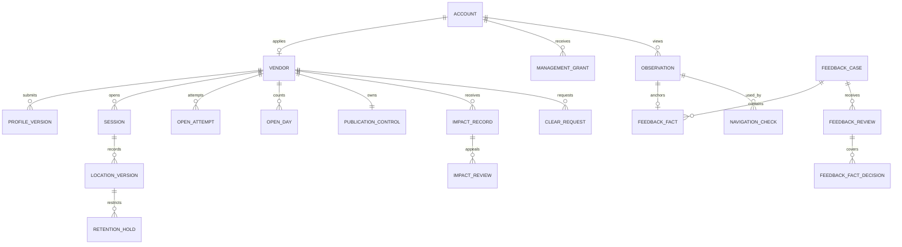

# 一期数据模型与接口约定

> 开发前准备资料第 4 项／共 6 项。状态：待审稿，尚未实施。本稿是一期 MVP 的拟定数据与 HTTP 契约；表、路由、迁移和小程序调用尚不存在或尚未按本稿改造。后续实施以[一期 MVP 需求文档](MVP/一期MVP需求文档.md)为业务依据，并与[页面与交互方案](一期页面与交互方案.md)、[技术设计](一期技术设计.md)共同核对。

## 1. 契约原则与时间表示

- 一期仅处理资料审核、权威营业轮次、当轮位置、当前发现与导航、现场反馈、两类公开限制、本人资料处理和必要管理。现有日历、预约、最近位置、信用及永久注销包装不进入本接口。
- MySQL 主库是状态和平台时间来源。数据库连接会话固定 UTC，所有 `*_at_ms` 是 Unix 毫秒时间点，API 同名字段是安全整数；`eventDate`、`openDate` 是 `Asia/Shanghai` 的 `YYYY-MM-DD`。营业、反馈窗口与清理期限均为左闭右开，比较前不四舍五入。
- 坐标链路统一 GCJ-02，数据库用 `DECIMAL(10,7)` 纬度、`DECIMAL(11,7)` 经度，HTTP 传数值；纬度范围 `[-90,90]`、经度 `[-180,180]`，还须通过微信定位结果及可导航位置校验。顾客位置只在请求体传递，不放 URL、访问日志或试点事件。
- 账号、轮次、位置、反馈、审核及清理的关系以不可复用的内部 ID 建立。沿用现有数据库“不建物理外键”的基线，但必须以唯一索引、事务校验及定期孤儿检查维持引用完整性。所有对外 ID 使用字符串表示，避免小程序将大整数读错；服务端转换并校验。
- 业务上可见的 `phase`、`remainingMs`、公开资格和反馈窗口由主库时刻与原始事实推导；不得只靠持久化布尔值、客户端倒计时或定时作业是否已跑来判断。

## 2. 逻辑关系与表职责

表名以下使用一期逻辑名；新迁移可采用同名 `cb_` 前缀。已存在的 `cb_vendor_locations` 属旧位置规则，不能直接当作一期位置版本表。

| 逻辑表／建议物理名 | 关键列（类型） | 约束与责任 |
| --- | --- | --- |
| ACCOUNT／`cb_accounts` | `id BIGINT`、`wx_openid VARCHAR(128)`、`version BIGINT`、`created_at_ms BIGINT`、`last_seen_at_ms BIGINT` | `wx_openid` 唯一，受限存储且不进顾客响应；一人一账号，免头像昵称手机号 |
| MANAGEMENT_GRANT／`cb_management_grants` | `id`、`account_id`、`role_code`、`status`、`source`、`valid_from_ms`、`valid_until_ms` | 部署受控配置建立授权；一期无人员授权 UI。角色权限见 §5，过期或撤销即时失效 |
| VENDOR／`cb_vendors` | `id`、`account_id`、`active_profile_version_id NULL`、`current_session_id NULL`、`state_version BIGINT`、`last_selected_clock_min SMALLINT NULL`、`created_at_ms` | `account_id` 唯一；`state_version` 为同摊主写入并发基准；资料是否生效看指针，不复制公开字段 |
| PROFILE_VERSION／`cb_vendor_profile_versions` | `id`、`vendor_id`、`version_no`、`task_version`、`vendor_name`、`category_code`、`regular_items_text`、`price_description`、`announcement`、`review_status`、`submitted_at_ms`、`decided_at_ms NULL` | 内容提交后不可原位修改；`(vendor_id,version_no)` 唯一；同摊主最多一份待审；仅 `APPROVED` 且被 VENDOR 指向的版本公开 |
| PROFILE_REVIEW／`cb_profile_review_events` | `id`、`profile_version_id`、`decision`、`reason`、`actor_account_id`、`decided_at_ms`、`operation_id` | 对同一待审版本只成立一个终态决定；保留提交版本与审核证据，驳回不动生效指针 |
| SESSION／`cb_vendor_sessions` | `id`、`vendor_id`、`profile_version_id`、`started_at_ms`、`planned_end_at_ms`、`ended_at_ms NULL`、`end_reason NULL`、`version` | 同摊主至多一条未物理结束轮次；到期未落库时新命令先按 `planned_end_at_ms` 终态化；结束原因区分手动、到期、本人、治理、管理纠错 |
| OPEN_ATTEMPT／`cb_vendor_open_attempts` | `id`、`vendor_id`、`planned_end_at_ms`、`status`、`accepted_at_ms`、`finished_at_ms NULL`、`session_id NULL` | 确认截止后开始定位就记一次意图；`LOCATING/SUCCEEDED/LOCATION_FAILED/TIME_FAILED/CANCELLED`；成功只能由开摊事务写入，失败和取消不形成轮次 |
| LOCATION_VERSION／`cb_session_locations` | `id`、`session_id`、`vendor_id`、`version_no`、`lat/lng DECIMAL`、`location_name`、`located_at_ms`、`effective_at_ms`、`stopped_at_ms NULL`、`stop_reason NULL` | `(session_id,version_no)` 唯一；同轮至多一条未停止版本；替换／结束同事务写各版本自身 `stopped_at_ms`，坐标受限保存 |
| OPEN_DAY／`cb_vendor_open_days` | `vendor_id`、`open_date DATE`、`first_session_id`、`created_at_ms` | `(vendor_id,open_date)` 唯一，只在主动成功开摊时插入；跨零点不补次日 |
| PUBLICATION_CONTROL／`cb_publication_controls` | `vendor_id`、`self_stopped_at_ms NULL`、`self_version`、`governance_paused_at_ms NULL`、`governance_version` | 两种限制独立；解除一方只清其自身列并增版本；所有变更另写审计与对本人有影响记录 |
| LOCATION_CONTEXT／`cb_location_contexts` | `id`、`token_hash`、`account_id`、`purpose`、`target_id NULL`、`issued_at_ms`、`expires_at_ms`、`used_at_ms NULL` | 一次开摊、刷新或反馈定位的一次性短期上下文；只存令牌摘要，不保存坐标。重复同键回放不能二次消费 |
| OBSERVATION／`cb_feedback_observations` | `id`、`viewer_account_id NULL`、`claim_token_hash NULL`、`version`、`vendor_id`、`session_id`、`location_version_id`、`event_at_ms`、`source`、`event_public_status` | 平台在详情展示或导航复核时建立事实引用；不存顾客坐标，未提交且受理窗口结束后清除；匿名上下文可一次性绑定本人 |
| NAVIGATION_CHECK／`cb_navigation_checks` | `id`、`observation_id`、`anonymous_session_hash`、`session_id`、`location_version_id`、`decision`、`created_at_ms`、`expires_at_ms` | 短期复核凭据只供同匿名会话发起导航；不存顾客坐标或旧导航坐标，过期清除；发起时重新核资格 |
| FEEDBACK_CASE／`cb_feedback_cases` | `id`、`reporter_account_id`、`vendor_id`、`event_date`、`feedback_type`、`status`、`task_version`、`result_reason_code NULL`、`opened_at_ms`、`closed_at_ms NULL` | 同人、摊主、异常发生日、问题类型至多一条待处理事项；已结案事项不被新事实重开 |
| FEEDBACK_FACT／`cb_feedback_facts` | `id`、`case_id`、`reporter_account_id`、`feedback_type`、`observation_id`、`session_id`、`location_version_id`、`event_at_ms`、`submitted_at_ms`、`description`、`reporter_lat/lng`、`reporter_located_at_ms`、`distance_m` | `(reporter_account_id,observation_id,feedback_type)` 唯一；反馈人坐标和历史营业坐标仅受限复核可读，依事项保留期清理 |
| FEEDBACK_REVIEW／`cb_feedback_review_events` | `id`、`case_id`、`result`、`reason`、`evidence_summary`、`actor_account_id`、`decided_at_ms` | 待处理事项一次终态核实；“无法核实”和“证明确无异常”使用不同原因码；重复复核返回已处理 |
| FEEDBACK_FACT_DECISION／`cb_feedback_fact_decisions` | `id`、`review_id`、`fact_id`、`result`、`reason_code`、`decided_at_ms` | 每条事实只对应一次终态判断；同一事项跨多个轮次时逐事实说明，试点按已确认事实的原轮次去重 |
| MANAGEMENT_ACTION／`cb_management_actions` | `id`、`action_type`、`vendor_id`、`target_session_id NULL`、`source_case_id NULL`、`reason`、`evidence_summary`、`actor_account_id`、`effective_at_ms` | 当前轮次纠错、治理暂停／解除及资料争议的受限处理记录；历史核实不自动生成当前纠错 |
| IMPACT_RECORD／`cb_vendor_impact_records` | `id`、`vendor_id`、`source_type`、`source_id`、`summary`、`status`、`created_at_ms`、`reviewable_until_ms`、`version` | 已确认反馈或管理措施对本人产生的影响；不复制反馈人身份或坐标；来源类型与 ID 唯一，撤销／修正保留历史 |
| CLEAR_REQUEST／`cb_data_clear_requests` | `id`、`account_id`、`vendor_id`、`scope_json`、`status`、`accepted_at_ms`、`due_at_ms`、`completed_at_ms NULL`、`result_summary_json` | 本人确认即成立；30 自然日截止；结果分别表述已隐藏、已清除和受限保留 |
| IMPACT_REVIEW／`cb_impact_review_requests` | `id`、`vendor_id`、`impact_record_id`、`statement`、`status`、`task_version`、`decision_reason`、`actor_account_id NULL`、`created_at_ms`、`decided_at_ms NULL` | 本人对影响结果的最小人工复核；不自动撤销公开限制，不代替清除请求成立 |
| RETENTION_HOLD／`cb_retention_holds` | `id`、`target_type`、`target_id`、`source_type`、`source_id`、`basis`、`opened_at_ms`、`closed_at_ms NULL`、`extended_due_at_ms NULL` | 未结关联事项阻止清理；结案后按事项结束＋30 日与位置自身＋180 日取较晚；争议延期记录依据与新截止 |
| AUDIT_EVENT／`cb_audit_events` | `id`、`action_code`、`actor_account_id NULL`、`target_type/id`、`occurred_at_ms`、`result_code`、`reason_summary`、`operation_id`、`retention_class` | 营业、位置生效／替换／停止、审核、反馈、两类限制与资料处理均可追溯；不把精确坐标复制到一般审计 |
| IDEMPOTENCY_OPERATION／`cb_idempotency_operations` | `id`、`actor_scope`、`operation_type`、`key_hash`、`request_hash`、`status`、`result_ref`、`created_at_ms`、`completed_at_ms NULL` | `(actor_scope,operation_type,key_hash)` 唯一；同键同内容回放结果引用，异内容冲突；不存坐标或受限证据的完整响应 |
| PILOT_EVENT／`cb_pilot_events` | `id`、`event_type`、`dedupe_ref`、`account_id NULL`、`vendor_id NULL`、`session_id NULL`、`occurred_at_ms`、`outcome` | `(event_type,dedupe_ref)` 唯一；只存试点汇总所需事实，导航发起不当作到达；不存顾客坐标 |

`PROFILE_VERSION`、`SESSION`、`LOCATION_VERSION` 是三种不同版本：资料审核后才切生效指针；营业轮次每次主动开摊新建；位置刷新只在原轮次内增加位置版本。反馈事实固定引用观察时的轮次和位置版本，任何后续刷新或同日重开都不能改写它。`PUBLICATION_CONTROL` 与营业轮次相互独立，限制生效时结束轮次，但解除限制不恢复轮次。

## 3. 字段枚举、校验与派生结果

| 契约 | 值及规则 |
| --- | --- |
| 一期资料 | `vendorName` 去首尾空白后 1～40 字；`categoryCode` 必须来自一期服务端品类表；`regularItemsText` 1～200 字；`priceDescription` 1～120 字；`announcement` 1～300 字。均按 Unicode 字符计数，拒绝纯空白和控制字符，不接受 HTML。将公告按必填处理，因为需求将其列为提交字段；如需可空，应先同步修订一期需求与表单 |
| 品类 | 服务端冻结一期可用品类码，当前小程序 `miniprogram/config/categories.js` 可作为初始化素材；客户端显示名与图标不是权限或筛选依据。未知码 `VALIDATION_FAILED`，不静默映射 `OTHER` |
| 资料审核 | `PENDING / APPROVED / REJECTED / INVALIDATED`；`INVALIDATED` 用于与清除范围相交的旧待审申请。审批为 `APPROVE / REJECT`，驳回原因必填 |
| 营业轮次 | 持久化 `ended_at_ms` 及 `end_reason`，不存第三种公开状态；结束原因 `MANUAL / DEADLINE / SELF_STOP / GOVERNANCE / CORRECTION`。有效营业 `started_at_ms ≤ N < planned_end_at_ms` 且未显式结束 |
| 准备收摊 | `R=E-N`，`T=min((E-S)×25%,60 分钟)`；`R>T` 正常，`0<R≤T` 准备，`R≤0` 休息。工作台与公开详情同一算法 |
| 位置版本 | `CURRENT` 仅表示本轮最后成功且未停止的版本；已替换 `SUPERSEDED`、轮次结束 `STOPPED`。不创建一期 `RECENT_LAST`；成功替换和所有结束路径必须写停止时刻 |
| 两类限制 | `selfStoppedAtMs` 与 `governancePausedAtMs` 独立可空；资格要求两者均为空。本人恢复不得清治理列，治理解除不得清本人列 |
| 反馈类型 | `OWNER_ABSENT / LOCATION_MISMATCH / ALREADY_LEFT`，分别对应“老板不在／地点不符／已经离开”。`description` 可空，非空最多 300 字；不接收照片和任意事件时间 |
| 反馈结果 | 事项 `PENDING / CONFIRMED / NOT_CONFIRMED`；逐事实结果为 `CONFIRM / NOT_CONFIRM`。未确认事实必带 `INSUFFICIENT_EVIDENCE` 或 `DISPROVED` 原因；事项全未确认且原因不同，事项摘要码为 `MIXED`，本人查看逐事实说明 |
| 定位核验 | 位置请求上下文从服务端签发到提交最多 5 分钟；反馈距原事件位置的未取整距离 `≤300m`。位置时间恰为 5 分钟和距离恰为 300 米可通过；任一超过则拒绝。坐标本身无法由服务端独立证明现场真实，试点抽查仍必须执行 |
| 受理窗口 | 原轮次营业中可提交；显式结束后 `N < ended_at_ms+30 分钟`；到期作业未落终态时用 `planned_end_at_ms` 作有效结束。恰好结束后 30 分钟关闭 |
| 当地自然日 | 开摊日取成功主动开摊 `S` 的上海当地日；反馈合并日取观察事件 `event_at_ms` 的上海当地日，不取提交日。一次轮次跨零点不自动增加次日开摊日 |

文本长度是本稿为可执行接口提出的上限，提交前需让页面校验与服务端校验使用同一契约；超限报字段错误并保留原输入，不截断后当作成功。服务端始终校验，客户端校验仅改善提示。

## 4. 公开与受限数据投影

| 投影 | 接收者 | 允许字段 | 明确排除 |
| --- | --- | --- | --- |
| 公开列表／地图 | 任意顾客 | `vendorId`、当前生效名称、品类、常卖摘要、营业阶段、预计收摊、最后定位时间、当前有效坐标；有顾客定位时可加距离 | 账号 ID、手机号、待审资料、历史位置、反馈和管理原因、顾客坐标 |
| 公开详情：营业 | 任意顾客 | 生效名称、品类、常卖内容、价格说明、公告、当前阶段、最后定位时间、预计收摊、当前有效坐标 | 内部版本、审核记录、精确反馈证据与旧坐标 |
| 公开详情：休息 | 任意顾客 | 仍允许公开的生效基本资料与“休息中” | 任何旧坐标、距离、导航令牌或上次营业时刻的坐标线索 |
| 不可查看 | 任意顾客 | `availability=UNVIEWABLE` 与通用说明 | 摊主资料、限制原因、坐标、距离；与已清除对象的内部差别 |
| 本人工作台 | 摊主本人 | 当前审核资格、两类限制、轮次、当前成功定位及真实时间、出摊日汇总、可执行动作和版本 | 其他顾客反馈人的身份与坐标 |
| 本人反馈／处理记录 | 提交者或摊主本人，按各自资源权限 | 必要事件摘要、状态、本人可见原因、处理时间、受限保留依据及期限 | 他人身份、反馈人精确坐标、管理证据全文和历史营业坐标 |
| 管理受限复核 | 有对应权限的管理人员 | 原轮次、原位置版本、事件与提交时状态、必要精确坐标、证据摘要和审计 | 与该任务无关的历史或其他账号信息；一般列表先显示摘要，详情逐次鉴权 |

公开列表、地图、详情和导航复核调用相同资格谓词：`有审核生效资料 ∧ 本人未停止 ∧ 治理未暂停 ∧ 存在当前轮次 ∧ S≤N<E ∧ 当前轮有效位置`。休息详情只在没有公开限制且仍有可公开生效资料时返回；限制或清除后返回不可查看。所有公开响应 `Cache-Control: no-store`。旧位置表和旧路由不得绕过投影；前台地图的“全部当前公开对象”不得用静默截断的第一页冒充完整集合。

## 5. HTTP 通用约定

全部路径以 `/api/v2` 为前缀，JSON 为唯一业务载荷；下表出现的 `{id}` 必须是十进制字符串并在服务端确认归属。成功响应统一 `{ "code": 200, "msg": "ok", "data": {...}, "requestId": "..." }`，错误响应统一 `{ "code": <HTTP状态>, "msg": <可展示说明>, "bizCode": <稳定语义码>, "data": <最小纠错信息>, "requestId": "..." }`。`requestId` 用于排障，与幂等键分别生成，不作为业务权限或位置令牌。创建成功仍可返回 HTTP 200；处理中返回 HTTP 202，客户端按原键查询。所有带 `serverNowMs` 的返回以同一次主库权威时刻判断资格。

所有写接口均要求 `Idempotency-Key`（1～64 个 ASCII 字母数字及 `._:-`），在一次用户意图产生时创建并在超时重试中复用；请求体不再另放会与请求头冲突的幂等键。服务端以操作者或匿名短期会话、操作类型和键的摘要去重，并对归一化请求体计算摘要。同键同内容返回原操作成立结果及 `replayed=true`；同键不同内容返回 `IDEMPOTENCY_MISMATCH`。回放只说明原操作结果，页面还需读取最新状态。`expectedVendorVersion`、`expectedSessionVersion`、`expectedSelfVersion`、`expectedGovernanceVersion` 或 `expectedTaskVersion` 只用于相应写接口；缺失时拒绝，不从客户端声明的角色或状态推断资格。匿名会话由服务端签发短期不可猜测标识，只用于请求去重和观察领取，不作为账号身份。

所有 `GET` 和公开查询均不得修改业务结果；需要记录详情观察事件时另调用 `POST /public/vendors/{id}/observations`。公开查询带顾客坐标只能使用 POST 请求体。本人或管理列表默认每页 20 项、最大 100 项，使用不透明游标和稳定的 `(业务时间,id)` 顺序；游标绑定当前权限与筛选条件，失效时要求重读。公开试点列表／地图采用同一完整快照，不设置会让地图静默丢摊位的默认分页；如容量测试不能满足时效，须另设计可完整访问的分块协议并更新本稿。

| 身份层级 | 允许的读取与操作 |
| --- | --- |
| 匿名顾客 | 公开列表、详情、导航前复核和匿名观察令牌；不读取本人记录、不提交反馈 |
| 已识别账号 | 上述能力，加本人观察绑定、反馈提交与本人记录；无手机号要求 |
| 本人摊主 | 只对自己提交资料、开收摊、刷新、公开控制、清除和复核申请；身份来自可信网关 |
| `PROFILE_REVIEWER` | 有权查看及决定资料申请，不自动取得治理暂停权 |
| `FIELD_REVIEWER` | 有权复核反馈、读取必要受限位置及核实当前轮次后纠错，不自动取得治理暂停权 |
| `ADMIN`／`SUPER_ADMIN` | 可实施／解除治理暂停和上述必要管理操作；`SUPER_ADMIN` 由部署受控配置，不提供一期授权工作台 |
| 受控作业身份 | 仅可调用到期与清理作业；不能代替用户或管理员调用业务接口 |

### 5.1 顾客公开接口

| 方法与路径 | 请求参数及权限 | 成功 `data` 核心字段 | 主要错误／边界 |
| --- | --- | --- | --- |
| `GET /public/categories` | 无身份；无参数 | `categories[{code,name,groupCode,defaultVisual}]`、`version` | 配置不可用 `SERVICE_UNAVAILABLE`；只返回一期可用码 |
| `POST /public/vendors/search` | 无身份；`categoryCode?`、`viewerLocation?:{lat,lng}`；禁止 `regionId/radiusM` | `serverNowMs`、`snapshotVersion`、`items[]`；每项含 `vendorId,name,categoryCode,regularItemsSummary,phase,plannedEndAtMs,lastLocatedAtMs,currentLocation`，有定位才含 `distanceM` | 空集合为 200＋`items:[]`，定位缺失仍返回全部；未知品类 `VALIDATION_FAILED`；旧位置不可混入 |
| `GET /public/vendors/{id}` | 无身份；对象 ID | `availability=OPEN/RESTING/UNVIEWABLE`、`serverNowMs`、`profile`、营业时的 `sessionSummary/currentLocation`；休息时后二者无坐标 | 不存在、已清除或受限统一为不可查看投影；休息无坐标、距离和导航资格 |
| `POST /public/vendors/{id}/observations` | 无身份；`source=DETAIL`、本次展示的 `sessionId/locationVersionId`、`Idempotency-Key` | `observationId`、`claimToken?`、`eventAtMs`、`vendorSummary`、`sessionSummary`；无坐标 | 提交时由服务端重新核对当时公开资格与版本；过时 `STATE_CONFLICT`，不允许客户端自填事件时刻 |
| `POST /public/vendors/{id}/navigation-check` | 无身份；`expectedSessionId?`、`expectedLocationVersionId?`、`confirmPrepared?:boolean`、`Idempotency-Key` | 正常且有效：`decision=READY,navigationCheckId,sessionId,locationVersionId,observationId,claimToken?`；准备收摊首次：`decision=CONFIRM_REQUIRED,plannedEndAtMs,remainingMs`；两者均无坐标；确认后再次复核才返回 `READY` | 已结束或限制 `NOT_NAVIGABLE`；版本变化 `STATE_CONFLICT`；网络失败客户端不能用缓存坐标 |
| `POST /public/navigation-launches` | 无身份；`navigationCheckId`＋幂等键；须是刚返回 `READY` 的本匿名会话复核 | `launchId,recordedAtMs,currentLocation,sessionId,locationVersionId`；客户端只用此响应坐标调用微信导航 | 复核已过期、轮次或位置变化、资格变化均拒绝且无坐标；发起记录不证明顾客已到达 |

`currentLocation` 仅含 `lat,lng,locationName,locatedAtMs`，来自本轮最新有效位置。列表与地图同源；无顾客定位时按稳定 `vendorId` 排序，有定位时按未取整距离再按 `vendorId` 排序。距离仅是展示结果，不用于半径筛除。详情固定价格与营业免责声明由页面呈现。准备收摊确认期间若轮次或位置变化，旧确认失效，用户看到新状态后重新决定。导航发起接口是紧邻外部导航调用的最后权限与状态复核；页面不得用详情、列表或先前复核响应的坐标发起导航。

准备收摊的首次复核和用户确认后的再次复核是两个不同操作，各自使用新幂等键；同一操作超时重试才复用原键。`navigationCheckId` 只在短期内有效，最后发起导航时再次以主库时刻核对轮次、位置版本和公开限制，失败时绝不返回历史坐标。

### 5.2 账号、资料与摊主接口

| 方法与路径 | 请求参数及权限 | 成功 `data` 核心字段 | 主要错误／边界 |
| --- | --- | --- | --- |
| `GET /me` | 可信账号；无参数 | `accountId`、`accountVersion`、`vendorId?`、`profileState`、`activeProfileVersionId?`、`selfStoppedAtMs?`、`governancePausedAtMs?`、`capabilities[]`、`stateVersion?` | 账号身份不可识别 `AUTH_REQUIRED`；无摊主时无 `stateVersion`；不返回平台原始 openid |
| `GET /vendor/profile` | 本人；无参数 | `activeProfile?`、`pendingSubmission?`、`latestDecision?`、`stateVersion`，含本人可见原因 | 首次无资料返回空对象，不伪造通过状态 |
| `POST /vendor/profile-submissions` | 本人；`vendorName,categoryCode,regularItemsText,priceDescription,announcement,expectedVendorVersion`＋幂等键 | `submissionId,versionNo,reviewStatus=PENDING,stateVersion` | 字段错 `VALIDATION_FAILED`；已有待审或版本变更 `STATE_CONFLICT`；清除中相交范围拒绝 |
| `GET /vendor/profile-submissions/{id}` | 本人；申请 ID | `submissionId,reviewStatus,decisionReason?,decidedAtMs?,activeProfileVersionId?` | 只读本人申请；驳回不变更生效资料 |
| `GET /vendor/workbench` | 本人；无参数 | `serverNowMs,vendorId,stateVersion,profileEligibility,publicationControls,session?,phase,remainingMs,currentLocation?,lastSelectedClockMin?` | 到期未物理结束亦返回休息；双重限制分别说明 |
| `POST /vendor/open-attempts` | 本人；`plannedEndAtMs,expectedVendorVersion`＋幂等键；在用户确认截止后、请求定位前 | `attemptId,acceptedAtMs,status=LOCATING` | 同一意图只记录一次；仅记试点尝试，不创建营业轮次或出摊日 |
| `POST /me/location-contexts` | 已识别本人；`purpose=OPEN/REFRESH/FEEDBACK`、`targetId?` | `locationContextToken,issuedAtMs,expiresAtMs` | 权限、目标轮次或观察事件不符拒绝；不接收坐标、不创建营业 |
| `POST /vendor/sessions/open` | 本人；`attemptId,plannedEndAtMs,locationContextToken,location:{lat,lng,locationName,locatedAtMs},expectedVendorVersion`＋幂等键 | `sessionId,startedAtMs,plannedEndAtMs,locationVersionId,stateVersion,openDate` | 未审核／受限 `NOT_ELIGIBLE`；时间无效 `TIME_INVALID`；定位无效 `LOCATION_INVALID`；冲突不形成轮次或出摊日 |
| `POST /vendor/open-attempts/{id}/finish` | 本人；`outcome=LOCATION_FAILED/TIME_FAILED/CANCELLED`＋幂等键 | `attemptId,status,finishedAtMs` | 成功只由开摊事务标记；客户端不能把失败改成成功；重复结果回放 |
| `POST /vendor/sessions/{id}/locations` | 本人；`locationContextToken,location,expectedSessionVersion`＋幂等键 | `sessionId,locationVersionId,lastLocatedAtMs,sessionVersion` | 旧轮次、到期或限制 `STATE_CONFLICT`；定位失败保留原位置和出摊日 |
| `POST /vendor/sessions/{id}/close` | 本人；`expectedSessionVersion`＋幂等键 | `sessionId,endedAtMs,endReason=MANUAL,sessionVersion` | 重试回放同一结果；别的结束路径已成立则返回当前终态，不再次结束 |
| `GET /vendor/open-days` | 本人；`cursor?,limit?` | `totalDays,rows[{openDate,sessionCount,firstStartedAtMs,lastEndedAtMs?}],nextCursor?` | 跨零点持续轮次不产生次日日期；不返回历史坐标 |
| `GET /vendor/publication` | 本人；无参数 | `selfStoppedAtMs?,governancePausedAtMs?,selfVersion,governanceVersion,stateVersion,activeProfileAvailable` | 不把双重限制合并为一个开关 |
| `POST /vendor/publication/stop` | 本人；`expectedSelfVersion`＋幂等键 | `selfStoppedAtMs,endedSessionId?,stateVersion,selfVersion` | 同事务结束本轮与位置；重复请求不产生新事件 |
| `POST /vendor/publication/resume` | 本人；`expectedSelfVersion`＋幂等键 | `selfStoppedAtMs:null,governancePausedAtMs?,stateVersion,selfVersion,profileEligibility` | 不解除治理，不恢复旧轮次；必需资料已清除时返回 `PROFILE_REQUIRED` 并引导重新审核 |

`locationContextToken` 是一次定位流程的受限令牌；服务端用签发与接收时刻控制 5 分钟新鲜度，客户端 `locatedAtMs` 仅用于辅助展示和合理性校验，不能单独证明现场时间。开摊定位与时间在获取摊主锁后再以平台时间重验。`lastSelectedClockMin` 只作下一次需用户确认的候选，早于当前的钟点按次日理解；同一时刻及超过 12 小时均拒绝。

### 5.3 现场反馈、资料处理与本人记录

| 方法与路径 | 请求参数及权限 | 成功 `data` 核心字段 | 主要错误／边界 |
| --- | --- | --- | --- |
| `POST /me/observations/claim` | 已识别账号；匿名详情或导航所得 `claimToken`＋幂等键 | `observationId,eventAtMs,vendorSummary,claimStatus=CLAIMED` | 令牌仅一次绑定原观察事实；已被别的账号领取 `STATE_CONFLICT`；不返回原坐标 |
| `GET /me/feedback-candidates` | 本人；`cursor?,limit?` | 可反馈的本人 `observationId,observationVersion`、事件摘要、`eligibleUntilMs`、资格原因及下一步定位要求 | 不用客户端浏览历史生成候选；窗口外只给不可提交原因 |
| `POST /me/field-feedback` | 本人；`observationId,type,description?,locationContextToken,location:{lat,lng,locatedAtMs},expectedObservationVersion`＋幂等键 | `feedbackFactId,caseId,status=PENDING,acceptedAtMs,eligibleUntilMs` | 原轮次／原位置版本定位距离超过 300 米 `LOCATION_TOO_FAR`；定位过期、窗口过期、重复事实、对象已处理均拒绝；不接受图片或自填事件时间 |
| `GET /me/field-feedback` | 本人；`cursor?,limit?` | `rows[{feedbackFactId,caseId,vendorSummary,type,status,resultReason?,submittedAtMs,decidedAtMs?}],nextCursor?` | 仅本人；无反馈返回空列表，不把待审当成立 |
| `GET /me/field-feedback/{id}` | 本人；事实 ID | 本人提交内容、事项状态、可公开处理理由与时间 | 隐藏其他提交者、管理证据、精确坐标 |
| `GET /me/data-clear-preview` | 本人；`scope=ACCOUNT_DATA/VENDOR_DATA/ALL` | `affectedKinds,activeSessionImpact,pendingReviewImpact,retentionExceptions,estimatedCompletion` | 列明清除后仍依法或按试点复核保留的最小记录；不把预览视为执行 |
| `POST /me/data-clear-requests` | 本人；`scope,expectedAccountVersion`＋幂等键 | `clearRequestId,status=QUEUED,requestedAtMs,affectedKinds` | 同事务先停本人的公开轮次与位置，待审资料置无效；批处理失败可重试，不能重新公开 |
| `GET /me/data-clear-requests`、`/{id}` | 本人；分页或申请 ID | 处理状态、已处理范围、保留依据与期限、失败重试状态 | 不披露其他账号；部分处理明确标记，不虚报完成 |
| `GET /me/impact-records` | 摊主本人；`cursor?,limit?` | 已确认反馈或管理措施形成的本人可见记录摘要、`impactVersion,reviewableUntilMs` | 待审或未确认反馈不可作为已成立影响；不含反馈人身份 |
| `POST /me/impact-reviews` | 摊主本人；`impactRecordId,reason,expectedImpactVersion`＋幂等键 | `impactReviewId,status=PENDING,submittedAtMs` | 同一影响的未结复核不重复创建；超过期限 `WINDOW_CLOSED` |
| `GET /me/impact-reviews/{id}` | 摊主本人；复核 ID | 申请内容、处理结论和本人可见理由 | 不泄露内部证据全文或第三人身份 |
| `GET /me/operations/{operationType}/{key}` | 原操作身份；操作类型与原幂等键 | `status=PROCESSING/SUCCEEDED/FAILED,result?`，结果仍经当前权限过滤 | 用于网络超时后确认结果；未知键返回 404，不能枚举其他人的键 |

观察事实在匿名浏览时生成并可用一次性令牌绑定账号；没有绑定账号就不能提交反馈。一次观察只关联一个服务端记录的原轮次和原位置版本，反馈接受时间与事件时间分开保存。对同一账号、同一观察、同一类型只接受一份事实；同一顾客、同一摊主、事件当地日、类型合并到一个待审事项，同一事项可包含不同轮次和位置版本的多条事实。跨顾客的同类事项在管理列表聚合展示，但不合并为同一事项。重复提交应回放原事实或返回明确重复错误，不重复增加人数。

### 5.4 管理端接口

所有管理路径每次从可信身份解析角色并按资源重新鉴权；管理列表只返回摘要，详情才取必要受限证据。管理写操作必须附操作者说明、预期版本和幂等键，并在同一事务写审计事件。管理入口在同一小程序“我的”中展示，但入口可见性不构成服务端权限。

| 方法与路径 | 请求参数及权限 | 成功 `data` 核心字段 | 主要错误／边界 |
| --- | --- | --- | --- |
| `GET /management/context` | 管理身份 | `roles,capabilities,queueCounts` | 权限变化后立即生效；无权限 `PERMISSION_DENIED` |
| `GET /management/profile-reviews`、`/{id}` | `PROFILE_REVIEWER`；状态筛选、游标或申请 ID | 待审摘要；详情含提交版本、`taskVersion`、当前生效版本、申请时间及审核历史 | 申请已失效或清除后仅受限审计可见，不批准旧申请 |
| `POST /management/profile-reviews/{id}/decision` | `decision=APPROVE/REJECT,reason?,expectedTaskVersion`＋幂等键 | `decisionId,reviewStatus,activeProfileVersionId?,decidedAtMs` | 批准只切换该版本为生效；驳回原因必填；并发审批一方成功，另一方 `STATE_CONFLICT` |
| `GET /management/field-feedback`、`/{id}` | `FIELD_REVIEWER`；状态筛选、游标或事项 ID | 摘要含类型、事实人数；详情含 `taskVersion`、各原事件／轮次／位置版本、受限证据、当前轮次单独标注 | 旧轮次证据不得被当前轮次位置替换；读取详情留审计 |
| `POST /management/field-feedback/{id}/decision` | `factResults:[{factId,result=CONFIRM/NOT_CONFIRM,reasonCode,reasonText?}],expectedTaskVersion`＋幂等键；须覆盖该事项所有当前事实 | `caseId,status,confirmedFactIds,impactRecordId?,decidedAtMs` | 任一事实确认则事项为 `CONFIRMED`，否则 `NOT_CONFIRMED`；逐事实理由区分证据不足与证明确无异常；不自动收当前摊 |
| `POST /management/sessions/{id}/corrections` | `FIELD_REVIEWER`；`sourceCaseId,action=CLOSE_CURRENT,reason,expectedSessionVersion`＋幂等键 | `sessionId,endedAtMs,endReason=CORRECTION,actionId` | 只能核对后关闭指定当前轮次；原事项关联旧轮次时，不能按旧 ID 误关新轮次 |
| `GET /management/vendors`、`/{id}/governance-context` | `ADMIN`／`SUPER_ADMIN`；查询或摊主 ID | 摘要；详情含双重限制、当前资格、最近处理记录和 `governanceVersion` | 搜索结果不公开顾客身份或无关位置历史 |
| `POST /management/vendors/{id}/governance-decisions` | `action=PAUSE/RESTORE,reason,expectedGovernanceVersion`＋幂等键 | `governancePausedAtMs?,endedSessionId?,governanceVersion,actionId` | 暂停同事务结束当前轮次；恢复只清治理列，不清本人停止，不复活旧轮次 |
| `GET /management/impact-reviews`、`/{id}`；`POST /management/impact-reviews/{id}/decision` | `ADMIN`／`SUPER_ADMIN`；查询；决定需 `decision,reason,expectedTaskVersion`＋幂等键 | 申请、关联影响、结论和审计 ID | 复核结论不删除原反馈事实，变更影响状态另留可追踪事件 |
| `GET /management/audit-events` | `SUPER_ADMIN`；受限筛选、游标 | 行为类型、操作者、目标、时间、结果、请求 ID | 默认脱敏；敏感详情逐次授权并留读取审计 |

### 5.5 受控作业接口

`POST /internal/jobs/close-due-sessions`、`POST /internal/jobs/clear-data`、`POST /internal/jobs/purge-retention` 只接受部署层验证的作业身份、`runId` 和批量上限。响应记录扫描范围、成功／跳过／失败数和下次游标；每条记录独立事务、可重复执行，作业失败可从游标或重新扫描恢复。到期作业仅按指定旧轮次 ID 与版本结束，不能作用于其后新开的轮次。内部路径不得被小程序网关公开转发。

### 5.6 共用对象、空值与请求示例

| 对象 | 字段与类型 | 规则 |
| --- | --- | --- |
| `LocationInput` | `lat:number,lng:number,locationName:string,locatedAtMs:number` | `locationName` 去空白后 1～80 字；`locatedAtMs` 为平台定位回调时间，服务端检查不晚于接收时刻、距提交不超过 5 分钟；仍须受 `locationContextToken` 的服务端期限约束 |
| `CurrentLocation` | `lat:number,lng:number,locationName:string,locatedAtMs:number` | 只在公开资格成立的列表、营业详情或最后导航发起响应中出现；休息／不可查看／错误体字段必须完全缺失，不能以 `null` 附旧坐标 |
| `PublicProfile` | `vendorId:string,name:string,categoryCode:string,regularItemsText:string,priceDescription:string,announcement:string` | 仅从当前生效且未被限制的资料版本读取；价格和公告按原提交文本展示并做转义，不采用待审版本 |
| `SessionSummary` | `sessionId:string,phase:OPEN/PREPARING,startedAtMs:number,plannedEndAtMs:number,remainingMs:number,lastLocatedAtMs:number` | `phase` 和剩余时间按同一 `serverNowMs` 计算，前端倒计时只作显示，操作前重验 |
| `WorkbenchSession` | `sessionId:string,version:number,startedAtMs:number,plannedEndAtMs:number,endedAtMs?:number,endReason?:string,phase:OPEN/PREPARING/RESTING,currentLocation?:CurrentLocation` | 结束后 `phase=RESTING` 且无可公开位置；本人工作台如需查历史位置另走受限复核，不能把它当导航坐标 |
| `Page<T>` | `rows:T[],nextCursor?:string` | 无下一页时省略 `nextCursor`；游标仅短期有效，不支持客户端猜测 offset；空页允许 `rows:[]` |
| `OperationRef` | `operationType:string,key:string,status:PROCESSING/SUCCEEDED/FAILED,result?:object` | 只查询原操作者的键；回放结果仍按当前身份脱敏；`FAILED` 有稳定错误码 |

所有时间戳为整数毫秒，所有业务 ID 和版本 ID 为十进制字符串；状态与品类是大小写固定的 ASCII 枚举。请求中未知字段一律报 `VALIDATION_FAILED`，防止旧客户端把 `recentLocation`、计划或预约字段偷偷写入一期；可选字段省略表示“不提供”，不可用空字符串代替。`null` 只在表中明确允许时使用。`expected*Version` 为非负安全整数，来自最近一次本人或管理读取。字段级错误 `data.fields` 是形如 `{ "field": "plannedEndAtMs", "reason": "OUT_OF_RANGE" }` 的数组，不含服务端敏感值。

开摊请求示例：`{"attemptId":"73","plannedEndAtMs":1793536200000,"locationContextToken":"...","location":{"lat":31.230416,"lng":121.473701,"locationName":"某路口","locatedAtMs":1793521800000},"expectedVendorVersion":6}`。服务端不信任示例时间，依接收时刻重新验证“晚于当前且不超过 12 小时”；`attemptId` 必须属于本人且仍为 `LOCATING`。

反馈请求示例：`{"observationId":"91","type":"OWNER_ABSENT","description":"到现场未见摊位","locationContextToken":"...","location":{"lat":31.230416,"lng":121.473701,"locationName":"某路口","locatedAtMs":1793521800000},"expectedObservationVersion":1}`。服务端从观察记录读取原轮次、原位置、事件时刻及当地日，不接受 `sessionId`、历史坐标或事件时刻由客户端覆盖。

清除范围 `ACCOUNT_DATA` 指本人非必要账号资料，`VENDOR_DATA` 指摊主公开资料与可清除的相关完整值，`ALL` 为两者合并；身份关联、未结事项证据、受限审计是否保留由预览逐类说明。请求成立后 `VENDOR_DATA`／`ALL` 立即停止本人公开，`ACCOUNT_DATA` 若仍有摊主资料则不能悄然删除登录关联并留下无主摊主；此类情形在预览和执行中按关联范围升级为 `ALL`，由用户明确提交对应范围。前端必须展示预览再提交。

## 6. 错误结果、版本与网络重试

| HTTP | `bizCode` | 触发与客户端动作 |
| --- | --- | --- |
| 400 | `VALIDATION_FAILED` | 缺字段、类型／长度／枚举／坐标范围不符；`data.fields` 仅列出可修正字段 |
| 401 | `AUTH_REQUIRED` | 需要可识别账号；重新走平台登录后保留尚未提交的表单 |
| 403 | `PERMISSION_DENIED`、`NOT_ELIGIBLE` | 无管理权限或本人资格不足；刷新权限／资格，不展示受限资源详情 |
| 404 | `RESOURCE_NOT_FOUND` | 本人或管理资源不存在或无权访问，统一返回以免枚举；公开详情另使用 `UNVIEWABLE` 投影 |
| 409 | `STATE_CONFLICT`、`IDEMPOTENCY_MISMATCH`、`ALREADY_PROCESSED` | 预期版本已变、旧定位对象、同键异内容或事项已有终态；必须读最新状态再给用户选择 |
| 410 | `WINDOW_CLOSED`、`CONTEXT_EXPIRED` | 反馈窗口、复核窗口或定位上下文已关闭；清理候选，允许重新定位仅适用于仍开放的轮次 |
| 422 | `TIME_INVALID`、`LOCATION_INVALID`、`LOCATION_TOO_FAR`、`PROFILE_REQUIRED`、`NOT_NAVIGABLE` | 业务输入不成立；导航错误绝不附坐标，定位错误不写营业事实 |
| 503 | `SERVICE_UNAVAILABLE` | 主库、可信身份或权威状态无法确认；前台标记状态未知并停止新发起导航，保留原幂等键重试 |

错误体示例：`{"code":409,"msg":"状态已更新，请刷新后重试","bizCode":"STATE_CONFLICT","data":{"resource":"session","currentVersion":8},"requestId":"req-..."}`。`currentVersion` 只在调用者有权读该资源时给出。内部 SQL 错误、坐标、手机号、openid、受限审核内容、令牌和堆栈不得写入面向顾客的错误体。定位拒绝与网络定位失败可在客户端区分文案，但都不能被当作成功营业或有效反馈。

请求到达服务器但客户端超时，客户端先按原键调用本人操作查询接口或重放同一请求；不得换键盲目再提交。`PROCESSING` 由客户端继续等待或查询，`FAILED` 只说明该键的已确定失败；无法确定数据库提交结果时服务端继续核查，不能提前宣告失败。管理决定和本人停止公开等不可由页面自动重发新意图。公开查询失败时，已缓存的坐标不能用于新的导航；前台恢复、页面停留和 60 秒内同步按技术设计的刷新机制执行。

## 7. 事务边界、索引与并发次序

| 场景 | 单事务成立的事实 | 必需约束／重试结果 |
| --- | --- | --- |
| 提交与审核资料 | 创建不可变申请；审批写决定、切换生效指针、版本和审计 | `(vendor_id,version_no)` 唯一；生成列约束每摊主最多一个 `PENDING`；同申请仅一个终态决定 |
| 开摊 | 校验资格、结束已到期旧轮、创建轮次及初始位置、写当地出摊日、审计／试点事件 | 摊主行锁串行化；生成列约束每摊主至多一个 `ended_at_ms IS NULL` 轮次；全部成功才返回开摊成功 |
| 刷新／结束轮次 | 旧位置停止、新版本生效或所有位置停止，更新轮次与审计 | `(session_id,version_no)` 唯一；生成列约束同轮最多一个未停止位置；旧轮请求不能改新轮 |
| 本人／治理限制 | 只更新各自控制列与版本，结束当时当前轮及位置，写影响／审计 | 两版本分别 CAS；治理解除不能清本人列，本人恢复不能清治理列；结束与限制同事务 |
| 提交反馈 | 锁定本人观察及原轮次，核时距／距离／窗口，插事实或合并本人的待审事项，写审计 | `(reporter_account_id,observation_id,feedback_type)` 唯一；待审事项生成列唯一键为 `(reporter_account_id,vendor_id,event_date,feedback_type)`；已结案不重开 |
| 处理反馈／纠错 | 事项决定写逐事实结果与影响；必要时另对明确指定的当前轮次执行纠错 | `factResults` 覆盖所有当时事实，版本锁防止漏掉并发补充；每事实仅一个终态；纠错目标轮次 ID 和版本必须重验，历史事项不隐式作用当前轮 |
| 资料清除 | 申请、立即停止公开和轮次、冻结交叉待审申请、生成清理任务与审计 | 清理作业逐项幂等；公开投影从申请成立起不可再读已申请清除的公开值 |

所有改变某摊主状态的命令先读取同一次数据库时间 `N`，锁 `VENDOR` 行，再依次锁控制、轮次、位置或资料版本；关联反馈再锁观察、事项与事实。跨摊主作业按 ID 升序处理且每摊主独立事务。若取得锁后时间已经跨过营业截止或反馈窗口边界，再读取主库时间重新校验，避免排队期间让过期请求成功。死锁与序列化失败只对同一幂等键作有限重试；不得重发不同键制造第二次决定。

MySQL 可用可空生成列实现“仅活动记录唯一”，但建迁移前需以目标 MySQL 版本验证表达式、索引长度和锁行为。无物理外键时，服务端在同一事务显式检查父记录；每日受控检查孤儿引用、错误生效指针、双活轮次、双活位置、出摊日与轮次不一致，并留异常报告。审计写入失败使对应业务写入整体失败；试点事件可使用事务性待投递记录异步汇总，确保不把重试算成新轮次。

## 8. 保留、清除与旧数据迁移

| 数据类别 | 默认截止与执行动作 | 例外／证明 |
| --- | --- | --- |
| 每个已停止公开的精确位置版本 | 从该版本 `stopped_at_ms` 起 180 个上海当地自然日后删除坐标或去标识化，停止时即不再公开 | 有关联未结反馈、复核或安全事项时，保留至事项结束后 30 自然日与默认截止较晚者；延期另记依据和新截止 |
| 一般资料审核与反馈证据 | 事项终态后 180 自然日删除或去标识化完整证据 | 未结事项不得按固定创建日提前删；保留最小结果与审计摘要可按其所属类别另行处理 |
| 管理与高风险治理审计 | 事件发生后 1095 自然日受限保存，期满清理 | 审计期限不自动延长精确坐标；确需延期需单独 `RETENTION_HOLD` |
| 本人清除请求 | 自请求成立起 30 自然日内清除可清除的非必要完整值 | 必要受限记录在结果中逐类列依据、范围、到期时间；未完工保留状态和可重试原因 |
| 未提交观察入口与定位上下文 | 反馈窗口关闭后移除候选并清理观察令牌；定位上下文到期即失效 | 已提交事实仍保留受限原引用；客户端不保存可复用旧坐标 |

“自某时刻起 N 个自然日”按该时刻在上海时区的本地日期与钟点加 N 日计算，截止不含该时刻；不把 180 天写死为毫秒常量。清理先去掉公开和普通列表可达路径，再按保留规则删除精确值，最后留不含可识别完整值的必要结果。删除后的引用应指向去标识化墓碑或保留最小审计键，不能让公开接口因空引用回退到旧版本。清理、保留延期和失败重试均写受限审计。

用户于 2026-11-01 已确认按一期需求从空库重新开始，旧代码与旧数据库不作为兼容目标。W1 使用独立迁移链，不迁移旧位置数据、不兼容旧迁移历史；只在新建的隔离空库验证初始化、重跑、校验和漂移、目标 MySQL 的索引与约束能力，不操作生产库。原先要求旧库盘点、双读对账及旧数据迁移的前置条件由此决定取代。保留现有旧文件，不因本决定批量删除旧代码或操作旧库。旧 `cb_vendor_locations` 的 `CURRENT_NAVIGATION/RECENT_LAST` 仍不符合一期公开规则；W5 上线切换门槛继续保留：清点旧公开路由与消费者，关闭旧公开坐标路由或接入统一公开投影，确保旧位置不能绕过一期资格判断。目标 MySQL 精确版本与隔离库仍待核实，取得实测证据前 W1 数据库验收不得标为完成。

## 9. 端到端契约样例与需求追踪

1. **同日刷新及重开。** 顾客 10:00 观察轮次 `S1`、位置 `L1`；摊主 10:05 刷到 `L2`，`L1.stoppedAtMs` 随即成立。顾客 10:10 以该观察提交反馈时，服务端使用 `S1/L1` 的原始坐标核 300 米，管理端看 `L1` 受限证据，顾客端只见事件摘要。若 `S1` 结束后同日新开 `S2`，旧反馈仍指 `S1/L1`；对 `S2` 的纠错需另核实并显式指定 `S2`。
2. **临界时间。** `N=plannedEndAtMs` 时公开搜索和导航资格立即失效，即使到期作业尚未写 `ended_at_ms`。结束后 `N<effectiveEndedAtMs+30min` 可按其他条件反馈，等号时返回 `WINDOW_CLOSED`。反馈定位时间差 `=5min` 且距离 `=300m` 允许，任何一项超过就不插事实。
3. **双重限制。** 本人停止和治理暂停各有独立时间／版本。本人恢复只清本人列，治理仍暂停则公开详情不可查看；治理解除后若本人仍停止也不可查看。所有限制切换时先结束原轮次，不通过旧位置重新公开。
4. **网络超时。** 开摊提交后客户端未收到响应，使用原 `Idempotency-Key` 查询操作或原样重放。服务端若已成功，返回同一个 `sessionId/locationVersionId`；若仍处理中，保持等待；若版本已变而原请求未提交，明确返回冲突并让用户刷新，不能产生第二个出摊日。

| 一期条款 | 本稿对应契约 |
| --- | --- |
| C-01、V-01／V-02 | 资料版本、审核、受控角色及生效指针；`/vendor/profile-submissions` 与 `/management/profile-reviews` |
| C-02、V-02～V-04、O-02／O-03 | 轮次／位置版本、出摊日、公开投影、导航复核、本人和治理独立限制 |
| C-03、AC-10／15～17 | 观察事实、原轮次／位置、反馈窗口、距离、同人同日同类合并与本人记录 |
| O-03、AC-19／20 | 资料清除、两类限制、影响复核、管理审计 |
| R-01～R-08 | 主库时间、重试及前台同步、权限和隐私、审计、保留期、时区和自然日边界 |

## 10. 待审决定与实施前核验

- 表单字段长度、公告必填、品类冻结码和 300 字说明是本稿给出的可执行建议，需与页面校验和产品文案逐项确认。未确认前不能以旧接口的字段缺省行为替代。
- 管理角色的具体账号、云环境、数据库版本、作业身份、试点名单和发布日期尚待部署配置；本稿只规定权限边界和配置校验，不预填真实值。
- 按 2026-11-01 空库决定，W1 不以真实旧库盘点或旧迁移历史兼容为前置条件；须在目标精确版本隔离空库验证迁移、索引和并发约束。W5 仍须核实旧公开路由与消费者并完成关闭或统一投影切换；完整公开集合的容量验证按对应工作包执行。发现与本稿不同的现实约束时先修订契约，再改代码。
- 第 5 项实施计划须将表迁移、身份边界、原子命令、公开投影、页面接入、作业与验收按依赖拆分；本稿本身不是开发授权。
