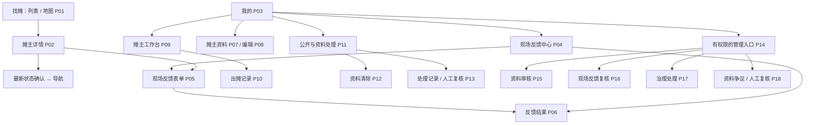

# 一期页面与交互方案

> 开发前准备资料第2项／共6项。状态：待审稿。
>
> 本文交付页面清单、入口关系、信息层级、操作和异常状态，以及可点击低保真原型；不制定后端方案、表结构、HTTP接口或实施任务。原型使用演示数据，不能视为已经实现的小程序。

## 1. 依据与已确认事项

业务依据为[一期MVP需求文档](MVP/一期MVP需求文档.md)，现状依据为[一期现有项目差距清单](一期现有项目差距清单.md)。此前撤回的六个功能 change 不作为本次依据。

本轮用户已确认：最小管理端放在同一小程序，从“我的→管理入口”进入；只覆盖一期审核、现场复核、治理和必要资料争议，不新增人员授权工作台。

本次其余布局为待审建议：底部采用“找摊／我的”，列表和地图在找摊页内切换，摊主工作台从“我的”进入。账号可兼具顾客、摊主和管理身份；切换工作界面不创建另一个账号，也不通过入口显示授予权限。

| 页面组织方式 | 影响 | 本稿取舍 |
| --- | --- | --- |
| 两个主入口，列表／地图同页 | 品类条件保持一致，顾客入口简单，工作台不挤占顾客导航 | 推荐，沿用现有两个底部入口的方向 |
| 地图单列第三个主入口 | 更直接但列表地图容易重复，需额外保持条件及选中对象一致 | 本稿不采用，业务能力仍完整 |
| 摊主工作台成为所有人的主入口 | 会让普通顾客面对与其无关的功能 | 本稿不采用 |

## 2. 视觉与原型边界

方向是本地找摊、清楚可信、短操作：暖白背景，深色正文，橙色主操作；营业、临近收摊、不可公开和信息未更新同时使用文字，不仅靠颜色。复用现有默认品类视觉，不要求摊主上传头像或图片。

每屏先显示当前结果，再显示必要时间和位置，最后给一个明确主操作。正文可读、触控区域不小于约44逻辑像素、底部操作避开安全区；颜色和尺寸为本稿视觉建议，不是业务规则。缺少数据时不加示例摊位填充真实页面。

[打开可点击低保真原型](prototypes/一期页面交互原型.html)。原型外侧可选页面和场景；屏幕内可点击导航、开收摊、公开控制、资料清除及管理确认等流程。所有对象、位置和时刻均为明显标注的演示，不调用定位、地图服务或业务接口，不保存真实账号或浏览历史。

## 3. 入口与页面地图

页面编号是设计引用，不规定最终代码路由。列表与详情、表单与结果可以在实现时共享组件，但不得混淆权威状态和公开边界。

### 3.1 顾客与公共页面

| 编号 | 页面／入口 | 核心内容与主要动作 | 必须处理的特殊状态 |
| --- | --- | --- | --- |
| P01 | 找摊；默认列表，页内切地图 | 品类、当前营业摊主、常卖摘要、阶段、预计收摊与位置更新时间；查看详情，定位仅用于距离 | 无供给、首次加载、读取失败、拒绝定位、定位不可用、状态未更新；地图不显示旧摊位和虚构点 |
| P02 | 从列表／地图摘要或旧链接进入详情 | 生效名称、品类、常卖内容、价格说明、公告、状态、位置更新时间、本轮收摊；主要动作“导航前往”，次要动作“反馈现场状态” | 正常、准备收摊、休息、不可查看、位置无效、断网；休息无坐标／距离／导航，不可查看不展示资料 |
| P03 | 我的 | 最小账号信息、现场反馈、申请／资料／工作台入口；仅有权限时显示管理入口 | 账号暂不可识别、未申请、审核中、驳回、通过及受限；不要求手机号头像昵称才能浏览 |
| P04 | 我的→现场反馈 | “可反馈的营业轮次／已提交”两组，必要事件摘要、平台记录时间、窗口情况 | 无可反馈项、无已提交项、已过窗口、对象已不可公开；不成为浏览历史 |
| P05 | 详情或P04→填写现场反馈 | 只读营业与平台事件摘要、三类问题单选、补充说明（可不填）、本次现场位置提示；“定位并提交反馈” | 定位拒绝／失败／过期／超距、窗口关闭、提交中、结果未知；无照片和任意时间输入 |
| P06 | 提交成功或P04→反馈结果 | 事件必要摘要、问题、提交时间、待处理／已核实／未核实、本人可见说明 | 无法核实与已证明不存在异常分别说明；无内部证据、管理备注或他人身份 |

P01的地图只改变空间展示方式，不建立第二套摊主状态。点击标记先出摘要卡，再进入同一P02；切列表／地图保留品类条件。拒绝顾客定位后不显示本人位置点及个人距离，仍显示所有当前公开营业摊位。

### 3.2 摊主页面

| 编号 | 页面／入口 | 核心内容与主要动作 | 必须处理的特殊状态 |
| --- | --- | --- | --- |
| P07 | 我的→摊主资料 | 未申请、申请结果、当前生效资料、本次待审修改；申请／修改、看原因 | 首次待审／驳回无开摊资格；修改待审和驳回不替换原生效内容 |
| P08 | P07→申请或修改 | 名称、品类、至少一项常卖内容／说明、价格说明、公告；核对并提交 | 字段错误定位到原项、提交中、未知结果、返回未保存提示；不放固定地址、日历、图片、福利 |
| P09 | 我的→摊主工作台 | 休息或出摊中；营业时重点显示正常营业／准备收摊、本轮截止与剩余、当前位置及真实定位时间 | 定位开摊中、取消／失败、时间失效、刷新失败、已到期、信息未更新、本人停止、治理暂停及双重限制 |
| P10 | 工作台→出摊记录 | 累计天数、按日基本记录、必要轮次开始与结束摘要 | 空记录、读取失败、跨日说明；不增加信用、计划履行或公开历史地图 |
| P11 | 我的→摊主资料与处理记录→公开与资料处理 | 独立显示本人公开选择、治理限制、资料状态；停止／恢复、清除入口、处理记录 | 双重限制分别显示，不共用一个开关；资料已清除时先补齐并审核 |
| P12 | P11→清除不再需要的资料 | 当前可清除范围、账号与影响确认、请求成立时间、最迟处理时刻、进度及结果 | 处理中、完成、部分必要受限保留、争议核查、结果未知；隐藏不等于已清除 |
| P13 | P11→处理记录／人工复核 | 对本人有影响的原因、结果、时间、最小人工复核说明与提交入口 | 待人工复核、已处理、无法加载；不展示反馈人位置身份或内部证据 |

P07与P08复用同一资料入口：内容修改是一份待审申请，不提供“当次营业临时修改长期资料”。本稿不擅自新增手机号验证、字段最大长度、公告可空或固定地址等规则；尚未明确的字段约束在业务／字段约定阶段确认，不能由原型校验代替需求。

### 3.3 同小程序的最小管理页面

| 编号 | 页面／入口 | 核心内容与主要动作 | 权限和状态 |
| --- | --- | --- | --- |
| P14 | 我的→管理入口 | 按有权范围显示资料审核、现场反馈复核、治理、资料争议与人工复核 | 无权限不显示入口；旧链接进入仍应显示无权结果，不能仅靠隐藏入口 |
| P15 | 管理→资料审核；列表／详情 | 首次或修改、申请内容、当前生效内容、必要审核历史；原因与通过／驳回 | 处理中、别人已处理、版本变化、结果未知；过时页面先刷新，不能覆盖新结果 |
| P16 | 管理→现场反馈复核；列表／详情 | 历史事实区：事件时间、原轮次／位置、提交时状态、必要受限证据；独立的当前营业区 | 已核实／未核实及说明；当前纠错与治理另操作，不默认勾选“核实并收摊” |
| P17 | 管理→治理处理 | 当前资格、本人公开选择与治理限制分别显示，暂停／解除的原因、影响、结果 | 仅管理员／最高权限可实施或解除；解除不能清除本人停止，不恢复旧营业位置 |
| P18 | 管理→资料争议／人工复核 | 必要申请摘要、本人诉求、受限核查信息、处理原因、结果及操作时间 | 是争议及人工复核的最小处理记录；不是本人停止或清除请求先受理后生效的审批门槛 |

P15／P16／P18的“列表／详情”是同一工作场景的两个视图，可能需要独立页面，不在此强定物理页面数。管理人员不因能复核现场反馈就自动拥有暂停公开权限；界面只呈现当前操作资格。完整角色分配、地域授权、规则配置和运营大屏不进入一期。

## 4. 共通状态与反馈规范

| 状态 | 用户可见表现 | 可继续做什么 |
| --- | --- | --- |
| 首次加载 | 结构占位／明确“正在加载”，不先显示“没有摊位” | 可返回；不提前提供依赖未知状态的动作 |
| 空数据 | 说明是无当前营业、无记录、无待审，分别处理 | 顾客可换品类／稍后重试；不造摊位填图 |
| 拒绝或无法顾客定位 | 局部提示“仍可浏览，不显示距离” | 列表地图可用；现场反馈需重新定位 |
| 读取失败 | 可理解原因和重试，避免把错误当成空结果 | 返回／重试 |
| 已显示内容但同步失败 | 明示“状态未更新，无法确认仍在营业” | 可刷新；不能用缓存新发起导航，不无提示保留“正在营业”承诺 |
| 恢复前台 | 先显示正在确认最新状态 | 取得新结果后恢复相关动作 |
| 写操作处理中 | 主按钮显示处理文字、防重复点击，不假定成立 | 等待或返回查询结果，不能触发相反操作覆盖未知状态 |
| 写结果未知 | “结果待确认，请查看最新状态”，不声称成功或失败 | “查看最新结果”；未确认前不重新创建另一条操作 |
| 目标状态已变化 | 明示“状态已变化，请查看最新结果” | 同步当前结果后重新选择，不按旧页面继续处理 |
| 无管理／本人权限 | 简洁无权结果，不展示受限资料 | 返回，不通过重新打开页面自动获得权限 |

这些规定描述可见行为，不选择轮询、推送、缓存、请求幂等或数据库实现。R-01前台最多60秒、R-02成功刷新后95%在5秒内用于顾客端等指标仍必须满足，具体技术在第三项确定。

## 5. 关键流程与弹层

### F01 找摊、详情与导航

找摊列表／地图→同一详情→“正在确认营业状态”：
- 正常营业且位置有效：取得本次最新结果后发起导航。
- 准备收摊：D01显示“预计今天／次日 HH:mm 收摊，约剩X分钟”，选择“暂不前往／继续导航”；继续时再次确认最新结果，防止弹层停留期间已截止或位置替换。
- 已休息：同步详情，移除旧位置、距离与导航入口。
- 对象本人停止或治理暂停：仅不可查看，不回载其资料。
- 无法确认：明确不能新发起导航，不回退缓存。已经发起的外部导航不承诺撤回。

详情固定简短说明：“价格仅供参考；平台提供找摊信息，不保证持续营业、有货或交易结果。”

### F02 现场反馈与原轮次

详情当前轮次或P04已有对象→P05只读必要事件摘要→选择问题、补充说明（可不填）→取得本次定位并核验→P06。

若本人具有多个平台记录事件，可从平台提供的事件项中选择；不提供自由填写发生时间、地图回选旧坐标或历史位置预览。刷新位置、收摊或同日重开不替换原对象。对象停止公开后摘要使用必要事件信息，不能以缓存名称／旧坐标恢复其完整资料。

定位距提交≤5分钟、距原事实当时有效营业位置≤300米，且在本轮仍营业或实际结束后不足30分钟的窗口内。恰好达到距离及定位时间上限可通过；到结束后30分钟立即关闭。窗口关闭保留当前未提交文字供用户查看，但禁用提交并说明原因；不承诺持久保存草稿。

成功显示“已提交，等待人工核实”；合并显示“已补充到待处理反馈”；重复事实不显示又新增成功。提交不自动处罚。窗口外未提交入口移除，已提交按保留规则可查询，不承诺永久保存。

### F03 首次资料与修改审核

我的→P07→P08核对提交→P07审核中→通过／驳回及原因。首次未通过不能开摊。

已有生效资料时，P07分区呈现“当前生效”和“本次修改待审核”；等待和驳回都继续使用原资料。修改驳回文案：“本次修改未生效，原资料继续使用。”表单错误保留输入并定位到字段，不将本地草稿直接展示给顾客。

### F04 定位开摊、刷新和收摊

休息工作台→D02本轮预计收摊时间→确认并取得本次实时定位→复核→成功才出现出摊中。选择器显示完整日期、今天／次日和时刻；默认推荐或上次候选均须本人确认。

首次推荐“当前时间后4小时并向上取整到30分钟”；晚于当前且从实际开摊到截止≤12小时，定位完成后再校验。失败、取消或时间失效保持休息，提示原因并可重试；同日再开仍走完整流程。

营业工作台显示真实最后定位时间，提示“移动地点后请主动刷新”，不写后台持续跟踪。刷新成功更新当前显示，失败保留上次成功位置与时间并提示失败。手动收摊可用D03确认结束本轮；到期不等摊主回来点按钮，复核后显示休息。准备收摊仍是出摊中，不提供延长营业。

P10说明：“同日多次开摊记一天；连续跨过零点不自动增加次日记录。”

### F05 本人停止、恢复与资料清除

P11将“本人公开选择”和“治理限制”作为独立信息区，不使用能互相解除的单开关。

- D04本人停止确认：核对当前本人账号及影响；成立即结束本轮、隐藏资料位置并禁止开摊，无需管理员受理，不记违规。
- D05恢复本人公开：说明不解除治理、不自动开摊、不恢复旧位置。已清除必要资料时先引导补齐并通过审核；无资料也不能直接显示恢复营业。
- P12及D06清除确认：先展示可清除范围、必要受限保留依据与期限、本人账号及影响。涉及当前公开资料时，成立即先停止公开；可清除非必要完整值自请求成立起30个自然日内清除，不等管理员受理。
- 结果分开显示“已停止公开”“清除处理中”“可清除资料已清除”“必要记录受限保留”，不能用已隐藏代替已删除，不显示永久注销成功。
- P13提供必要处理原因及人工复核；提出复核不自动解除限制。

### F06 人工审核、现场核验与治理

P15审核详情对比当前资料与申请资料，填必要原因后通过D07确认处理；查看成立结果、处理人与时间。被他人处理或版本变化时先更新，未知结果先查询。

P16分开“核实历史事实”和“当前营业纠错”：前者只记录事实核验结果，后者必须另显示当前目标轮次、当前异常依据及影响后确认。不能让核实旧轮次默认结束后续新轮次。

P17治理暂停／解除使用D08独立确认，告知结束本轮／隐藏内容或仅解除治理的影响，并校验当下权限。P18仅处理必要争议与本人复核，不建立信用申诉中心，也不把资料清除改成人工审批制。

### 5.1 弹层清单

| 编号 | 场景 | 主要动作 | 取消／失败 |
| --- | --- | --- | --- |
| D01 | 准备收摊导航 | 继续导航前再确认当前结果 | 暂不前往；失败关闭本次导航 |
| D02 | 本轮预计收摊 | 显示今天／次日与完整时间，确认并定位开摊 | 暂不开摊；定位或时间失败仍休息 |
| D03 | 手动收摊 | 结束当前轮次 | 取消不改变营业；结果未知先查询 |
| D04 | 本人停止公开 | 核对本人及影响后立即停止 | 取消不改变公开 |
| D05 | 本人恢复公开 | 只解除本人选择，不恢复旧状态 | 资料不全先补齐；治理仍有效 |
| D06 | 清除资料 | 确认范围、账号、期限及必要保留 | 取消不建请求；成立后直接处理 |
| D07 | 管理处理确认 | 对当前申请／事实及原因确认 | 状态变更刷新，未知结果查记录 |
| D08 | 治理／当前营业纠错 | 明确动作、当前目标、依据及影响 | 无权不可执行；历史核实不连带处理 |

## 6. 页面状态覆盖表

“未更新”与“结果未知”是不同状态：前者不能确认当前业务，后者不能确认刚才的写操作是否成立。

| 页面 | 读取／空 | 定位异常 | 断网／状态变化 | 写入与结果未知 |
| --- | --- | --- | --- | --- |
| P01 | 加载、无当前营业／无该品类 | 不显示距离仍浏览 | 标未更新、失效标记同步移除 | 无写业务 |
| P02 | 加载、休息、不可查看 | 摊主无有效营业位置不能导航；顾客拒绝自身定位仅不显示距离，仍可复核后导航 | 复核失败禁导航，恢复先确认 | 导航确认未通过不发起 |
| P03 | 加载、账号暂不可识别 | 不阻塞 | 仅个人入口不可用 | 切工作界面不改业务状态 |
| P04～06 | 空入口／空记录、受理结束 | 拒绝、失败、过期、超距 | 绑定原对象，关闭窗口不可提交 | 提交中、待确认、合并／重复结果 |
| P07～08 | 无资料、待审、驳回、修改对比 | 不适用 | 输入可保留，过时申请先更新 | 提交中、待确认，查申请结果 |
| P09 | 休息、营业、临近收摊、限制 | 开摊失败仍休息，刷新失败保留 | 标未更新，恢复确认最新状态 | 各动作处理中／待确认，不反向覆盖 |
| P10 | 无记录／加载失败 | 不展示历史地图 | 重试 | 无写业务 |
| P11～13 | 两类限制、清除进度、处理记录 | 不以位置或手机号作确认前提 | 最新选择变化时先更新 | 单项操作处理中、待确认，查成立时间 |
| P14～18 | 无任务／加载失败／无权 | 历史位置只在有权复核区 | 权限或目标变化先停止操作 | 处理中、已被处理、待确认，不重复治理 |

## 7. 原型审阅路线

在原型外侧选择页面与状态，屏幕内点击关键动作；每条路线都可用“复位原型”重新开始。

1. P01列表／地图及拒绝定位→P02正常、准备收摊→D01→休息／不可查看／未更新。
2. P03→P07首次与修改审核→P08→P09休息→D02→营业→刷新失败→D03收摊→P10。
3. P03→P04→P05，查看定位拒绝、超距、过期和窗口关闭→P06待处理／不同未核实说明。
4. P11双重限制→恢复本人公开，治理保持→P12清除确认／处理中／受限保留→资料已清除需补齐。
5. P14→P15资料对比审核→P16旧事实与新轮次分区→P17独立治理→P18最小人工复核。

原型展示的是拟议交互，不执行真实授权、定位、地图导航、状态同步、审核或数据清理。若原型简化与本文细节不一致，以一期业务需求和本文明确规则为准，审阅后修订，不把原型内存状态当真实实现。

## 8. 一期验收的页面承接

| 场景 | 页面／流程 |
| --- | --- |
| AC-01 | P01拒绝定位、列表地图及无距离 |
| AC-02 | P07／P08首次审核、P09资格受限 |
| AC-03 | P09＋D02，P01／P02营业展示 |
| AC-04 | P09定位／时间失败及取消 |
| AC-05 | P09刷新成功／失败，P01／P02更新显示 |
| AC-06 | P02＋D01准备收摊确认 |
| AC-07 | P02休息、导航复核失败关闭 |
| AC-08 | P09到期回休息，P01／P02同步；任务正确性留后续设计验收 |
| AC-09 | P10日记录及跨日说明 |
| AC-10 | P04～06、P16人工复核 |
| AC-11 | P17＋D08、P09受限与P02不可查看 |
| AC-12 | P07／P15原生效与修改对比 |
| AC-13 | P14～18无权旧入口、每次操作权限结果 |
| AC-14 | P09真实定位时间与刷新失败，顾客端不假装持续跟踪 |
| AC-15 | P05距离／定位时间边界提示 |
| AC-16 | P04／P05原事实，P16历史与当前分区 |
| AC-17 | P04窗口内找回与已提交，P05不任意填写时间 |
| AC-18 | P01／P02未更新与禁用新导航 |
| AC-19 | P11～13、D04～06的独立限制、清除、补齐资料 |
| AC-20 | P02不返旧位置；P11～12向本人说明处理结果、必要保留依据与期限；历史精确坐标和内部核验记录仅供有权管理使用 |

R-01／02对应时效与未更新；R-03对应处理中和未知结果；R-04／05对应必要字段与受限记录；R-06对应后置能力不入页面；R-07对应记录及清除期限；R-08对应完整日期时间和截止不含端点。此表只证明设计承接，不宣称业务已通过验收。

## 9. 设计审阅与后续边界

本次需要审阅的是：两个主入口、18类页面场景、关键弹层、异常状态与原型是否清楚；同小程序管理载体已经用户确认，不再重复询问。

本稿不把字段长度、具体权限来源、事件记录机制、状态同步方式、表结构或接口参数写成既定技术实现。这些在后续第三、第四项资料中形成；第五项才制定实施计划。真实部署资源及试点日期名单属于第六项和试点启动前输入。

本轮仅允许修改页面方案、原型和准备资料进度，不推进前述六个功能 change，不编写小程序业务代码，也不因审阅本文自动进入第三项。

## 10. 本轮检查与审阅记录

- 已由独立子智能体对照一期需求复核文档，修正“顾客拒绝定位仍可复核后导航”和“本人可查必要保留依据期限”的表述。
- 主会话检查原型脚本语法、静态HTML及113个场景的标签配对；23条关键连续交互检查通过，涉及两类限制不互相解除、收摊后不导航旧位置、未更新地图不承诺营业、反馈合并及重复、定位边界、时间边界与历史核实不结束新轮次。
- [离线检查记录](prototypes/一期原型离线检查记录.json)仅代表原型脚本和场景逻辑检查。没有业务接口、生产权限、实时定位、清理作业或性能验收结果。
- 浏览器预览工具拒绝本地file协议，未完成浏览器视觉验收和微信真机检查；不绕过该限制，可手动在本地浏览器打开原型审阅。CSS提供窄屏布局与触控／键盘状态，但实际视觉仍需审阅。

待审内容：主入口、页面信息、关键操作与异常提示是否符合预期。用户确认后仍只完成第二项资料；下一项技术设计另行继续。

